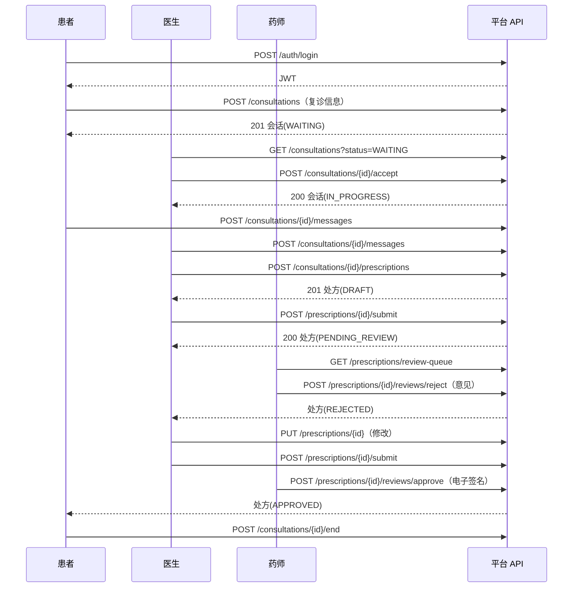

# API 契约设计说明（API Contract）

## 文档信息

| 项目 | 内容 |
|---|---|
| 项目名称 | 互联网医院在线问诊与处方流转平台 |
| 文档名称 | API 契约设计说明（api-contract.md） |
| 配套规范 | `backend/src/main/resources/openapi.yaml`（OpenAPI 3.0.3，机器可读契约） |
| 文档版本 | v1.0 |
| 作者 | 李梓语（角色：问诊域、处方域负责人） |
| 创建日期 | 2026-11-06 |
| 适用轮次 | 第 2 轮：架构、接口与工程骨架 |
| 上游依据 | `docs/requirements/requirements.md` v1.0（需求基线） |

### 修订记录

| 版本 | 日期 | 修订人 | 修订内容 |
|---|---|---|---|
| v1.0 | 2026-11-06 | 李梓语 | 建立认证、问诊、处方（含审核）v1 接口契约 |

---

## 1 文档目的与范围

本文档定义平台 v1 版本对外 HTTP API 的设计约定、接口清单、错误模型、权限边界与验证方式，作为前后端并行开发的"合同"：前端（角色 代香晰）按契约调用，后端（角色 刘飞燕/李梓语/郝佳鑫）按契约实现，测试（角色 郝佳鑫）按契约推导用例。契约合并后，任何破坏兼容性的修改均须走版本升级或 PR 评审。

本轮契约覆盖三个业务域：

1. **认证域（Auth）**：注册、登录、登出、当前用户；
2. **问诊域（Consultation）**：会话发起、接诊、消息收发、会话结束；
3. **处方与审核域（Prescription / Review）**：开方、修改、提交、撤销、药师审核通过/驳回、审核记录。

流转、核销相关接口属第 5 轮范围，本契约仅预留 `/prescriptions/{id}` 状态扩展，不定义核销端点。

---

## 2 设计原则

| 原则 | 说明 |
|---|---|
| 资源导向 | 以名词复数表达资源（`/consultations`、`/prescriptions`），动作通过 HTTP 方法表达；业务动作使用子资源（`/accept`、`/submit`、`/reviews/approve`） |
| 无状态 | 每次请求自带 JWT，服务端不保存会话上下文，便于水平扩展 |
| 契约先行 | OpenAPI 文件先于实现合并，前后端以同一版本契约为准，禁止口头约定字段 |
| 统一模型 | 分页结构、错误结构、时间格式、命名风格全系统统一 |
| 显式权限 | 每个端点标注允许角色，并在服务端做"角色 + 资源归属"双重校验 |
| 可演进 | 新增字段/端点保持向后兼容；删除、改类型、改语义必须升版本 |

---

## 3 通用约定

### 3.1 Base URL 与版本

```text
http(s)://{host}:{port}/api/v1
```

- 版本号 `v1` 置于 URL 路径中；不兼容变更升级为 `/api/v2` 并与 v1 并行过渡期；
- 所有请求与响应均使用 `application/json; charset=utf-8`。

### 3.2 认证与授权

- 登录成功后返回 JWT，后续请求在请求头携带：`Authorization: Bearer <accessToken>`；
- JWT 载荷包含 `sub`（用户 ID）、`role`（角色）、`exp`（过期时间）；
- 服务端依次完成：令牌有效性校验 → 角色校验（RBAC）→ 资源归属校验（如医生只能操作本人会话）；
- 公开端点：患者注册、医护注册、登录；其余端点默认需要认证。

### 3.3 HTTP 方法语义

| 方法 | 语义 | 典型场景 |
|---|---|---|
| GET | 安全、幂等的查询 | 查询会话、处方、消息列表 |
| POST | 创建资源或触发业务动作 | 发起问诊、接诊、开方、审核 |
| PUT | 整体更新可修改资源 | 修改草稿/驳回态处方 |
| DELETE | 本期不使用 | 业务数据一律逻辑删除，不提供物理删除端点 |

### 3.4 请求头约定

| 请求头 | 必填 | 说明 |
|---|---|---|
| `Authorization` | 认证端点必填 | `Bearer <token>` |
| `Content-Type` | 写请求必填 | 固定 `application/json` |
| `Idempotency-Key` | 可选 | 客户端生成的 UUID，关键写操作携带后服务端保证幂等；第 5 轮核销端点强制要求 |

### 3.5 分页与排序

列表类 GET 接口统一支持查询参数：

| 参数 | 默认 | 说明 |
|---|---|---|
| `page` | 0 | 从 0 开始的页码 |
| `size` | 20 | 每页条数，最大 100 |
| `sort` | 按创建时间倒序 | 格式 `字段,asc|desc`，如 `createdAt,desc` |

统一分页响应：

```json
{
  "content": [],
  "page": 0,
  "size": 20,
  "totalElements": 100,
  "totalPages": 5,
  "last": false
}
```

### 3.6 数据与时间格式

- 字段命名：JSON 统一 `camelCase`；
- 时间字段：ISO 8601 带时区偏移，如 `2026-11-06T14:30:00+08:00`；
- 金额：十进制数字，单位为元，保留两位小数，如 `128.50`；
- 枚举字段：大写下划线字符串，如 `PENDING_REVIEW`。

### 3.7 幂等约定

携带 `Idempotency-Key` 的写请求，服务端对同一 key 缓存首次处理结果；重复请求直接返回首次结果，不重复创建业务数据。未携带 key 的请求按正常流程处理，客户端须自行防重。

---

## 4 统一响应与错误模型

### 4.1 成功响应约定

| 场景 | 状态码 | 响应体 |
|---|---|---|
| 创建成功 | 201 Created | 新建资源对象 |
| 查询/修改/业务动作成功 | 200 OK | 资源对象或分页对象 |
| 无响应体的动作 | 200 OK | `{ "success": true }`（如登出、撤销） |

### 4.2 错误响应结构

```json
{
  "code": "CONSULTATION_NOT_FOUND",
  "message": "问诊会话不存在或已归档",
  "details": ["consultationId=10086"],
  "timestamp": "2026-11-06T14:30:00+08:00",
  "path": "/api/v1/consultations/10086"
}
```

### 4.3 HTTP 状态码与业务错误码

| HTTP | 业务错误码 | 含义 | 触发示例 |
|---|---|---|---|
| 400 | `BAD_REQUEST` | 请求格式或参数错误 | JSON 格式非法、分页参数越界 |
| 401 | `UNAUTHORIZED` | 未认证或令牌失效 | 缺失/过期 Bearer Token |
| 403 | `FORBIDDEN` | 已认证但无权限/越权访问 | 药师调用开方接口、医生操作他人会话 |
| 404 | `*_NOT_FOUND` | 资源不存在 | 会话/处方 ID 不存在 |
| 409 | `ILLEGAL_STATE` | 资源状态不允许该操作 | 对已审核处方再次提交、重复接诊 |
| 422 | `VALIDATION_FAILED` | 字段校验失败 | 密码长度不足、明细为空、药品数量 ≤ 0 |
| 429 | `RATE_LIMITED` | 触发限流 | 短时间内重复发送消息 |
| 500 | `INTERNAL_ERROR` | 服务端未预期异常 | 统一兜底，禁止泄露堆栈信息 |

---

## 5 接口清单

### 5.1 认证域（Auth）

| 方法 | 路径 | 权限 | 说明 |
|---|---|---|---|
| POST | `/auth/register/patient` | 公开 | 患者注册（含实名信息） |
| POST | `/auth/register/staff` | 公开 | 医生/药师注册（含执业资质，待管理员审核） |
| POST | `/auth/login` | 公开 | 账号密码登录，返回 JWT 与用户信息 |
| POST | `/auth/logout` | 已认证 | 登出，令牌加入失效列表 |
| GET | `/auth/me` | 已认证 | 获取当前登录用户详情 |

### 5.2 问诊域（Consultation）

| 方法 | 路径 | 权限 | 说明 |
|---|---|---|---|
| POST | `/consultations` | 患者 | 发起复诊问诊，创建 WAITING 会话 |
| GET | `/consultations` | 全角色 | 会话列表；患者看本人、医生按 `status=WAITING` 看待接诊 |
| GET | `/consultations/{id}` | 会话相关方 | 会话详情，含归属校验 |
| POST | `/consultations/{id}/accept` | 医生 | 接诊，WAITING → IN_PROGRESS |
| POST | `/consultations/{id}/messages` | 患者/医生 | 发送文本或图片消息 |
| GET | `/consultations/{id}/messages` | 会话相关方 | 分页拉取消息历史 |
| POST | `/consultations/{id}/end` | 患者/医生 | 结束会话，IN_PROGRESS → ENDED |

### 5.3 处方域（Prescription）

| 方法 | 路径 | 权限 | 说明 |
|---|---|---|---|
| POST | `/consultations/{id}/prescriptions` | 医生 | 在进行中会话内开具处方（DRAFT） |
| GET | `/prescriptions` | 全角色 | 处方列表，支持 `status` 过滤与归属过滤 |
| GET | `/prescriptions/{id}` | 相关方 | 处方详情，含明细与金额 |
| PUT | `/prescriptions/{id}` | 医生 | 修改 DRAFT/REJECTED 态处方 |
| POST | `/prescriptions/{id}/submit` | 医生 | 提交审核，DRAFT/REJECTED → PENDING_REVIEW |
| POST | `/prescriptions/{id}/cancel` | 医生 | 撤销处方，→ CANCELLED（终态） |

### 5.4 审核域（Review）

| 方法 | 路径 | 权限 | 说明 |
|---|---|---|---|
| GET | `/prescriptions/review-queue` | 药师 | 待审核队列（PENDING_REVIEW） |
| POST | `/prescriptions/{id}/reviews/approve` | 药师 | 审核通过并电子签名，→ APPROVED |
| POST | `/prescriptions/{id}/reviews/reject` | 药师 | 驳回并必填意见，→ REJECTED |
| GET | `/prescriptions/{id}/reviews` | 医生/药师 | 审核记录追溯 |

---

## 6 关键业务接口编排



---

## 7 接口权限矩阵

| 端点 | 患者 | 医生 | 药师 | 管理员 |
|---|---|---|---|---|
| 注册/登录 | ● | ● | ● | － |
| POST /consultations | ● | － | － | － |
| POST /consultations/{id}/accept | － | ● | － | － |
| 会话消息 | ●（本人会话） | ●（本人接诊） | － | 只读监管 |
| 开方/修改/提交/撤销 | － | ● | － | － |
| 审核队列/通过/驳回 | － | － | ● | － |
| GET /prescriptions | ●（本人） | ●（本人开具） | ● | ●（脱敏） |

> 所有"本人"限制由服务端依据 JWT 中的用户 ID 与资源归属字段二次校验，前端隐藏入口不等于安全边界。

---

## 8 需求追溯

| 需求条目（requirements.md） | 对应接口 |
|---|---|
| FR-AUTH-01~05 | `/auth/*` 全部端点 |
| FR-CONS-01~05 | `/consultations*` 全部端点 |
| FR-RX-01~04 | `/consultations/{id}/prescriptions`、`/prescriptions/*` |
| FR-REV-01~04 | `/prescriptions/review-queue`、`/prescriptions/{id}/reviews/*` |
| NFR-SEC-03（越权拒绝） | 权限矩阵 + 403 错误码 |
| NFR-SEC-05（幂等） | `Idempotency-Key` 约定 |

---

## 9 兼容性与变更策略

1. **允许的兼容变更**：新增可选请求字段、新增枚举值（客户端须容忍未知枚举）、新增端点、新增响应字段；
2. **禁止的破坏变更**：删除/重命名字段、修改字段类型、改变错误码语义、收紧已公开的权限；确需变更时升 `/api/v2`；
3. OpenAPI 文件与实现保持同版本，实现偏离契约以契约缺陷处理，须先改契约再改代码；
4. 每次契约变更须在修订记录登记，并通知前端与测试负责人。

---

## 10 本地验证方式

1. 用 Swagger Editor / VS Code OpenAPI 插件打开 `backend/src/main/resources/openapi.yaml`，确认无语法错误；
2. 后端引入 `springdoc-openapi` 后，启动工程访问 `http://localhost:8080/swagger-ui.html` 可视化调试；
3. 合并前用 curl/Postman 对登录全链路做一次手动验证，保存请求响应记录到 PR；
4. 前端可借助 OpenAPI 生成器按 yaml 生成请求客户端与 TypeScript 类型，减少手写字段错误。
