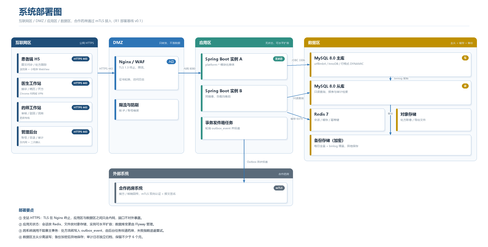

# deploy —— 部署配置与本地编排（魏宇佳、班国勇）

第 1 轮只确定部署结构和网络分区，`docker-compose.yml`、Nginx 配置、初始化脚本在第 5 轮补上。
本目录现在的产出是部署图与部署说明，供第 2 轮搭骨架时对照。

## 1. 部署图



- 位图：[`deployment.png`](../docs/database/diagrams/deployment.png)
- 矢量：[`deployment.svg`](../docs/database/diagrams/deployment.svg)
- 生成脚本：[`scripts/render_deployment.py`](../scripts/render_deployment.py)

## 2. 分区与职责

| 分区 | 放什么 | 访问策略 |
|---|---|---|
| 互联网区 | 患者 H5、医生/药师工作站、管理后台 | 仅经 HTTPS 443 访问，不直连数据库 |
| DMZ | Nginx / WAF，负责 TLS 终止、限流、访问日志 | 只做转发，不落业务数据 |
| 应用区 | Spring Boot 实例（无状态，可多副本）、事务发件箱任务 | 只经内网访问数据区，8080 不对外 |
| 数据区 | MySQL 主从、Redis、对象存储、备份存储 | 仅应用区可达，运维走跳板机 |
| 外部系统 | 合作药房 | mTLS 双向认证 + 报文签名 |

## 3. 端口与连接

| 连接 | 端口 | 协议/要求 |
|---|---|---|
| 浏览器 → Nginx | 443 | HTTPS（TLS 1.3），80 端口只做 301 跳转 |
| Nginx → 应用 | 8080 | 内网 HTTP，不经公网 |
| 应用 → MySQL 主库 | 3306 | JDBC，写操作与事务 |
| 应用 → MySQL 从库 | 3306 | 只读查询、报表、审计检索 |
| 应用 → Redis | 6379 | 会话、缓存、幂等键 |
| 应用 → 药房 | 443 | mTLS + 签名，经事务发件箱异步投递 |

## 4. 关键设计

1. **应用无状态**：会话放 Redis，文件放对象存储，实例可水平扩容；数据库变更由 Flyway 管理，启动时不自动改表。
2. **不阻塞主事务**：处方流转写入 `outbox_event`，后台任务投递药房，失败按指数退避重试，超过阈值告警。
3. **读写分离**：主库承担写与状态迁移，从库承担列表、报表与审计检索；主从延迟超过阈值时降级为读主库。
4. **备份**：每日全量 + binlog 增量，备份文件加密后异地保存；每学期做一次恢复演练。
5. **审计独立**：`audit_log` 单独归档，保留不少于 6 个月，业务库清理不影响审计。

## 5. 环境变量约定

配置通过环境变量注入，仓库不保存任何密钥：

| 变量 | 用途 |
|---|---|
| `DB_HOST` / `DB_PORT` / `DB_NAME` | 主库地址 |
| `DB_USER` / `DB_PASSWORD` | 应用账号（只有增删改查权限，无 DDL） |
| `REDIS_HOST` / `REDIS_PORT` | 缓存与幂等 |
| `JWT_SECRET` | 令牌签名密钥 |
| `PHARMACY_MTLS_CERT` / `PHARMACY_MTLS_KEY` | 药房双向认证证书（本地用自签） |

## 6. 第 5 轮要做的事

- [ ] `docker-compose.yml`：MySQL 8 + Redis 7 + 应用 + Nginx
- [ ] `nginx.conf`：TLS、限流、静态资源
- [ ] `init/01-schema.sql`：导入 `database/schema.sql`
- [ ] `init/02-seed.sql`：演示种子数据（虚构）
- [ ] 一键启动脚本与健康检查

---

## 7. 本地编排（R2-F）

第 2 轮由 F 负责：把"起本地环境"这件事从口口相传变成可执行文件。

### 包含什么

| 文件 | 作用 |
|---|---|
| `docker-compose.yml` | MySQL 8 + Redis 7 + 后端三个服务，一条命令起停 |
| `README.md` | 端口、环境变量、常用命令与排错 |

后端镜像使用 `backend/Dockerfile` 构建（多阶段：Maven 编译 → JRE 运行），
所以 `deploy/` 与 `backend/Dockerfile` 需要一起 review。

### 快速开始

```bash
# 仓库根目录执行
docker compose -f deploy/docker-compose.yml up -d --build

# 看状态：三个容器应为 running，mysql/redis 为 healthy
docker compose -f deploy/docker-compose.yml ps

# 跟踪后端日志，出现 Started PlatformApplication 即启动完成
docker compose -f deploy/docker-compose.yml logs -f backend

# 停止；加 -v 连数据卷一起删
docker compose -f deploy/docker-compose.yml down
```

启动后：

| 地址 | 说明 |
|---|---|
| `http://127.0.0.1:8080` | 后端 HTTP 端口 |
| `127.0.0.1:3306` | MySQL，账号 `root` / 密码见环境变量 |
| `127.0.0.1:6379` | Redis，无密码（仅本地） |

### 环境变量

所有变量都有演示用默认值，不需要 `.env` 也能跑；需要覆盖时在 `deploy/`
下新建 `.env`（已被 `.gitignore` 忽略，**不要提交**）。

| 变量 | 默认值 | 说明 |
|---|---|---|
| `SERVER_PORT` | `8080` | 后端对外端口 |
| `DB_ROOT_PASSWORD` | `root` | MySQL root 密码，仅本地演示 |
| `DB_NAME` | `medical_platform` | 初始化库名（`MYSQL_DATABASE`） |
| `DB_PORT` | `3306` | MySQL 对外端口 |
| `REDIS_PORT` | `6379` | Redis 对外端口 |

容器内后端通过服务名连接：`DB_HOST=mysql`、`REDIS_HOST=redis`，
对应 `backend/src/main/resources/application.yml` 里的 `${DB_HOST}` / `${REDIS_HOST}`。

### 与数据库的关系

- `database/schema.sql` 是第 1 轮的表结构草案，**不会**被 compose 自动执行：
  首次起来后按需手动导入（`docker compose exec -T mysql mysql -uroot -proot < database/schema.sql`）。
- Flyway 目前 `FLYWAY_ENABLED=false`，等 E 把 `database/migrations/` 落地后再打开。

### 排错

| 现象 | 处理 |
|---|---|
| `port is already allocated` | 本机 3306/6379/8080 被占用，改 `.env` 里的 `DB_PORT`/`REDIS_PORT`/`SERVER_PORT` |
| `backend` 一直 restarting | 先看 `logs backend`：多数是 MySQL 还没 healthy，等 30s 或 `up -d` 重试 |
| `docker: command not found` | 本机没装 Docker Desktop，CI 里只用 `docker compose config` 做静态校验 |
| 想彻底重来 | `docker compose -f deploy/docker-compose.yml down -v` 后重新 `up` |
