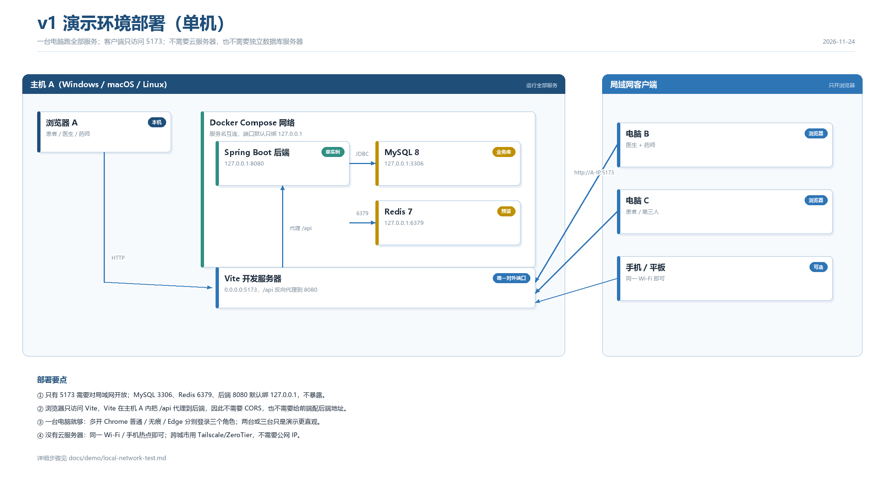
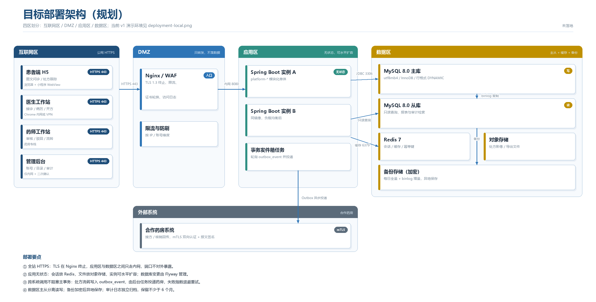

# deploy —— 本地编排与演示环境

`docker-compose.yml` 起 **MySQL 8 + Redis 7 + Spring Boot 后端** 三个容器。v1 不包含 Nginx、TLS、MySQL 主从和对象存储；四区部署图是目标架构，不是当前环境。

## 1 当前实际部署（v1）



- 位图：[`deployment-local.png`](../docs/database/diagrams/deployment-local.png)
- 矢量：[`deployment-local.svg`](../docs/database/diagrams/deployment-local.svg)
- 多机连接步骤：[`docs/demo/local-network-test.md`](../docs/demo/local-network-test.md)

| 组件 | 位置 | 默认端口 | 说明 |
|---|---|---|---|
| MySQL 8 | 主机 A（容器） | `127.0.0.1:3306` | 业务库，首次启动执行 V002–V005 与 `seed.sql` |
| Redis 7 | 主机 A（容器） | `127.0.0.1:6379` | 预留；v1 业务代码未使用 |
| 后端 | 主机 A（容器） | `127.0.0.1:8080` | Spring Boot 单实例 |
| 前端 | 主机 A（Vite） | `0.0.0.0:5173` | 唯一对局域网开放的端口，`/api` 代理到 8080 |
| MySQL/Redis/后端 | 不对局域网开放 | — | 避免把数据库暴露给同网段 |

## 2 一条命令起演示环境

```bash
docker compose -f deploy/docker-compose.yml up -d --build
docker compose -f deploy/docker-compose.yml ps
docker compose -f deploy/docker-compose.yml logs -f backend
```

MySQL 第一次初始化（数据卷为空）会按文件名顺序执行：

```text
10-core → 20-auth-consult → 30-prescription → 40-circulation → 90-seed
```

建完表直接带演示数据。重置数据：

```bash
docker compose -f deploy/docker-compose.yml down -v
docker compose -f deploy/docker-compose.yml up -d --build
```

> `down -v` 会删数据库卷，只在演示数据可丢时使用。

演示账号（密码都是 `Demo@2026`）：

| 账号 | 角色 | 能做什么 |
|---|---|---|
| `patient01` | 患者 | 发起问诊、查看处方、选择药房发起流转 |
| `doctor01` | 医生 | 接诊、发消息、开方、提交审核 |
| `pharmacist01` | 药师 | 审核、接方、核销 |
| `admin` | 管理员 | 查看全部数据 |

## 3 前端与局域网

```bash
cd frontend
pnpm install
pnpm dev
```

`vite.config.ts` 已设置 `host: '0.0.0.0'`，Vite 会打印：

```text
Local:   http://localhost:5173/
Network: http://192.168.1.23:5173/
```

其他电脑打开 `Network` 那一行即可。Windows 防火墙放行 `5173`：

```powershell
New-NetFirewallRule -DisplayName "Medical Demo 5173" `
  -Direction Inbound -Protocol TCP -LocalPort 5173 -Action Allow -Profile Private
```

浏览器不需要知道后端地址，也不需要 CORS：所有 `/api` 请求由 Vite 在主机 A 内转发到 `127.0.0.1:8080`。

## 4 端口绑定与覆盖

`docker-compose.yml` 用 `BIND_HOST` 控制三个服务绑定的网卡，默认 `127.0.0.1`：

```yaml
ports:
  - "${BIND_HOST:-127.0.0.1}:${SERVER_PORT:-8080}:8080"
```

只有在你确实需要“其他电脑直接访问后端 8080”时，才这样起：

```powershell
$env:BIND_HOST='0.0.0.0'
docker compose -f deploy/docker-compose.yml up -d
```

正常多机演示不需要改；浏览器统一走 5173。

## 5 环境变量

所有变量都有演示默认值，不需要 `.env` 也能跑。需要覆盖时在 `deploy/` 下新建 `.env`（已被 `.gitignore` 忽略，不要提交）。

| 变量 | 默认值 | 说明 |
|---|---|---|
| `BIND_HOST` | `127.0.0.1` | 端口绑定网卡；局域网直连后端时才改 `0.0.0.0` |
| `SERVER_PORT` | `8080` | 后端宿主端口 |
| `DB_ROOT_PASSWORD` | `root` | MySQL root 密码，仅本地演示 |
| `DB_NAME` | `medical_platform` | 初始化库名 |
| `DB_PORT` | `3306` | MySQL 宿主端口 |
| `REDIS_PORT` | `6379` | Redis 宿主端口 |
| `JWT_SECRET` | 代码内演示默认值 | 生产/公网必须覆盖 |

容器内后端通过服务名连接：`DB_HOST=mysql`、`REDIS_HOST=redis`。

## 6 目标部署（未落地）



- 位图：[`deployment.png`](../docs/database/diagrams/deployment.png)
- 矢量：[`deployment.svg`](../docs/database/diagrams/deployment.svg)
- 生成脚本：[`scripts/render_deployment.py`](../scripts/render_deployment.py)

目标态包括互联网区 / DMZ / 应用区 / 数据区、Nginx/WAF、两个后端实例、MySQL 主从、Redis、对象存储、合作药房 mTLS。当前 compose 没有这些，答辩时按“目标方案”讲。

| 分区 | 目标职责 | 当前状态 |
|---|---|---|
| 互联网区 | 患者 H5、医生/药师工作站、管理后台 | 浏览器直连 Vite |
| DMZ | Nginx/WAF、TLS 终止、限流 | 未实现 |
| 应用区 | Spring Boot 多副本、outbox 任务 | 单实例，无 outbox |
| 数据区 | MySQL 主从、Redis、对象存储、备份 | 单 MySQL + 单 Redis |
| 外部系统 | 合作药房 mTLS | 未接入 |

目标态端口规划：浏览器 → Nginx 443；Nginx → 应用 8080；应用 → MySQL 3306；应用 → Redis 6379；应用 → 药房 443（mTLS）。这些是规划，不是当前 compose 的实际端口。

## 7 排错

| 现象 | 处理 |
|---|---|
| `port is already allocated` | 本机 3306/6379/8080 被占用，改 `.env` 的 `DB_PORT`/`REDIS_PORT`/`SERVER_PORT`；后端换端口时前端要同步 `VITE_PROXY_TARGET` |
| `docker` 报 named pipe 找不到 | Docker Desktop 没启动，先启动再 compose |
| `backend` 一直 restarting | 先看 `logs backend`：多数是 MySQL 还没 healthy，等 30s 或 `up -d` 重试 |
| 其他电脑打不开 5173 | 确认同一网段、`host: '0.0.0.0'`、防火墙放行 5173；公司/学校 Wi-Fi 可能开了 AP 隔离 |
| 页面能开但接口 502 | Vite 代理找不到后端；`docker compose ps` 看 backend 是否 running |
| `docker: command not found` | 本机没装 Docker Desktop；也可用本机 MySQL + `mvn spring-boot:run` |
| 想彻底重来 | `docker compose -f deploy/docker-compose.yml down -v` 后重新 `up` |
