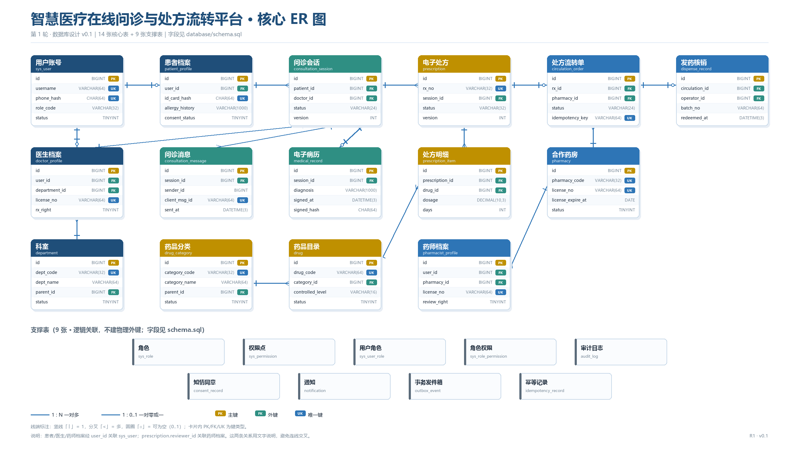
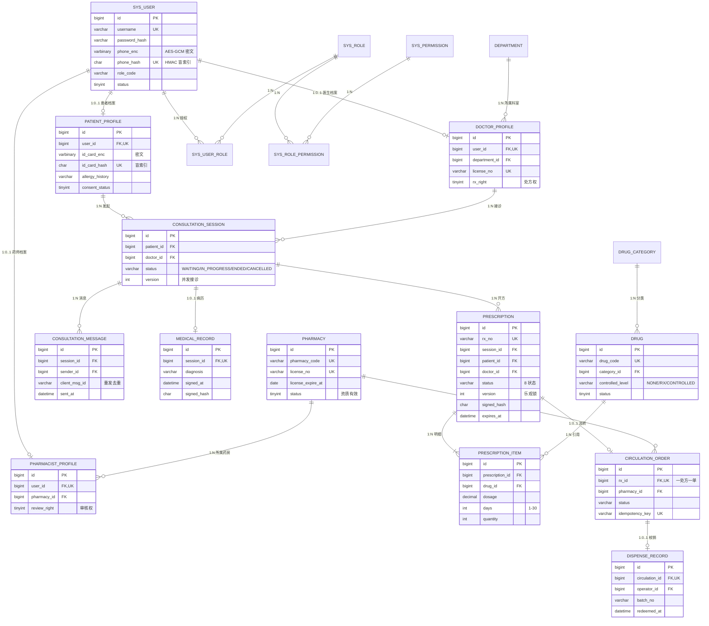

# 数据库表关系说明与 ER 图

> 对应报告 3.2 节与图 3-5。字段级定义见 [`database/schema.sql`](../../database/schema.sql)，
> 表清单见 [`table-list.md`](./table-list.md)。

## 0. 图与数据字典



| 产物 | 文件 | 用途 |
|---|---|---|
| ER 图（位图） | [`diagrams/er-core.png`](./diagrams/er-core.png) | 直接插入报告，2600 × 1480 |
| ER 图（矢量） | [`diagrams/er-core.svg`](./diagrams/er-core.svg) | 用 draw.io 或 Visio 修改 |
| 表总览图 | [`diagrams/table-overview.png`](./diagrams/table-overview.png) | 24 张表按业务域分组 |
| 数据字典 | [`dictionary.xlsx`](./dictionary.xlsx) | 24 张表、235 个字段、索引与外键 |
| 生成脚本 | [`render_er_diagram.py`](../../scripts/render_er_diagram.py)、[`render_table_overview.py`](../../scripts/render_table_overview.py)、[`build_dictionary.py`](../../scripts/build_dictionary.py) | 改完 DDL 重跑即可同步 |

图中画了 14 张核心表，标注 PK/FK/UK 和 15 条关系基数；9 张支撑表在底部单独列出，
只做逻辑关联、不建物理外键。第 3 节的 Mermaid 图是同一份关系的可编辑版本。

## 1. 关系总述

数据关系的主线是这样的：

```text
患者 ──发起──▶ 问诊会话 ──书写──▶ 病历
                    │
                    └──开具──▶ 处方 ──明细──▶ 药品(目录)
                                  │
                                  └──流转──▶ 流转单 ──核销──▶ 发药记录
```

- **身份是入口**：所有业务表的 `patient_id` / `doctor_id` / `pharmacist_id` 都指向档案表，
  档案表再 1:1 关联 `sys_user` 账号，账号通过 `sys_user_role` 挂角色、`sys_role_permission` 挂权限点。
- **会话是诊疗主线**：一个患者可发起多个会话；一个会话只有一名接诊医生、一条病历；
  会话未结束时医生才能开方。
- **处方是业务核心**：处方归属唯一会话，明细指向目录药品；处方审核通过后才能流转。
- **流转是跨机构边界**：一张处方最多一张流转单，一次流转最多一条发药记录，
  核销结果不可回退，重复请求由幂等表拦截。
- **审计横切**：审计、通知、发件箱、幂等表只做逻辑关联，不建物理外键。

## 2. 关系明细

| 关系 | 基数 | 实现方式 | 说明 |
|---|---|---|---|
| `sys_user` — `patient_profile` | 1 : 0..1 | `patient_profile.user_id` 唯一 | 一个账号最多一个患者档案 |
| `sys_user` — `doctor_profile` | 1 : 0..1 | `doctor_profile.user_id` 唯一 | 医生必须有执业证书编号 |
| `sys_user` — `pharmacist_profile` | 1 : 0..1 | `pharmacist_profile.user_id` 唯一 | 药师归属唯一药房 |
| `sys_user` — `sys_role` | N : M | `sys_user_role` 关联表 | 支持一人多角色（如医生兼管理员） |
| `sys_role` — `sys_permission` | N : M | `sys_role_permission` 关联表 | 权限点粒度到 `rx:approve` |
| `department` — `doctor_profile` | 1 : N | `doctor_profile.department_id` | 科室决定候诊队列与处方权范围 |
| `pharmacy` — `pharmacist_profile` | 1 : N | `pharmacist_profile.pharmacy_id` | 药师审核数据范围 = 所属药房 |
| `patient_profile` — `consultation_session` | 1 : N | `consultation_session.patient_id` | 患者可多次问诊 |
| `doctor_profile` — `consultation_session` | 1 : N | `consultation_session.doctor_id` | 接诊后写入，未接诊为空 |
| `consultation_session` — `consultation_message` | 1 : N | `consultation_message.session_id` | 消息按 `sent_at` 排序 |
| `consultation_session` — `medical_record` | 1 : 0..1 | `medical_record.session_id` 唯一 | 结束问诊时生成，签名后锁定 |
| `consultation_session` — `prescription` | 1 : N | `prescription.session_id` | 一次会话可开多张处方（如补充处方） |
| `prescription` — `prescription_item` | 1 : N | `prescription_item.prescription_id` | 明细 ≥1 条才能提交审核 |
| `drug` — `prescription_item` | 1 : N | `prescription_item.drug_id` | 停用药品不得新开 |
| `drug_category` — `drug` | 1 : N | `drug.category_id` | 目录两级分类 |
| `prescription` — `circulation_order` | 1 : 0..1 | `circulation_order.rx_id` 唯一 | 一处方一流转单 |
| `pharmacy` — `circulation_order` | 1 : N | `circulation_order.pharmacy_id` | 药房接方前校验资质有效期 |
| `circulation_order` — `dispense_record` | 1 : 0..1 | `dispense_record.circulation_id` 唯一 | 一次核销一条记录 |

## 3. 核心 ER 图

下图覆盖 24 张表中的 16 张主干表；`sys_permission`、`consent_record`、`notification`、
`outbox_event`、`idempotency_record`、`audit_log` 等支撑表为单向逻辑关联，为避免连线过密未绘出，
其字段与索引见 `schema.sql`。



> 说明：图中 `FK,UK` 为“既是外键又唯一”的简写标注；若所用渲染器不支持多键写法，
> 可按 `FK` 单独显示，字段与约束的权威定义始终以 `schema.sql` 为准。

## 4. 外键策略

| 表类型 | 是否建物理外键 | 原因 |
|---|---|---|
| 业务核心表（患者、医生、会话、消息、病历、处方、明细、药品、药房、流转、发药） | 建 | 保证引用完整性，防止“孤儿数据” |
| 审计表 `audit_log`、同意 `consent_record` | 不建 | 账号/业务数据删除后审计必须留存 |
| 事件表 `outbox_event`、通知 `notification`、幂等 `idempotency_record` | 不建 | 高写入、需独立归档与清理，避免级联与锁等待 |

外键统一命名 `fk_<表简称>_<引用对象>`，例如 `fk_rx_session`、`fk_circ_pharmacy`。

## 5. 与报告图 3-5 的对应关系

| 报告图 3-5 元素 | 本文件对应 |
|---|---|
| 核心实体（患者、医生、处方、药房、流转单） | 第 3 节 Mermaid 图中的同名实体 |
| 聚合根标记 | `patient_profile`、`consultation_session`、`prescription`、`circulation_order` 为聚合根 |
| 跨聚合只连 ID | `prescription.session_id`、`circulation_order.rx_id` 只存 ID，不做对象导航 |
| 多重性标注（1、0..*、1..0..1） | 第 2 节“基数”列与图中 `1:N` / `1:0..1` 标注 |

若后续调整表结构，先改 `schema.sql`，再同步本文件与报告图 3-5，避免文档与库不一致。
