# 四端演示走查与截图（R6-C）

> 本文档对应第 6 轮 C 任务“演示流程打磨与截图”，用于答辩演示、报告插图与联调前的自查。
> 截图来自 `frontend/mock/server.mjs` 的演示数据（虚构），通过 Vite 代理访问，未使用真实患者信息。

## 1. 环境与账号

```bash
# 终端 1：启动 mock（端口 18080，8080 被占用时用这个）
cd frontend
MOCK_PORT=18080 node mock/server.mjs

# 终端 2：启动前端并指向 mock
VITE_PROXY_TARGET=http://127.0.0.1:18080 pnpm dev
```

Windows PowerShell：

```powershell
$env:MOCK_PORT='18080'; node mock/server.mjs
$env:VITE_PROXY_TARGET='http://127.0.0.1:18080'; pnpm dev
```

| 角色 | 账号 | 密码 | 说明 |
|---|---|---|---|
| 患者 | `patient` | `123456` | 张小明，已有进行中/待接诊/已核销处方 |
| 医生 | `doctor` | `123456` | 李医生，待接诊队列有 1 条 |
| 药师 | `pharmacist` | `123456` | 王药师（仁和药房），待审处方与流转单 |
| 管理员 | `admin` | `123456` | 管理端页面（R2 骨架） |

> 真实后端启动后，直接 `pnpm dev`（默认代理 8080）即可；mock 与真实接口路径一致，字段以 `docs/design/api-contract.md` 为准。

## 2. 五分钟演示路径

### ① 登录

四端共用登录页；演示阶段可用下方“演示账号”一键填充。

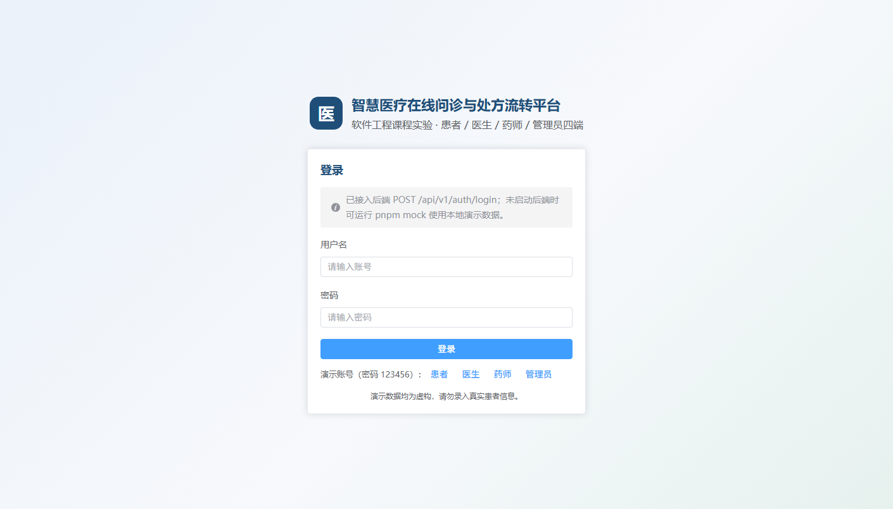

### ② 患者首页

展示进行中问诊、待接诊数量与最近问诊；右上角可快捷发起问诊。

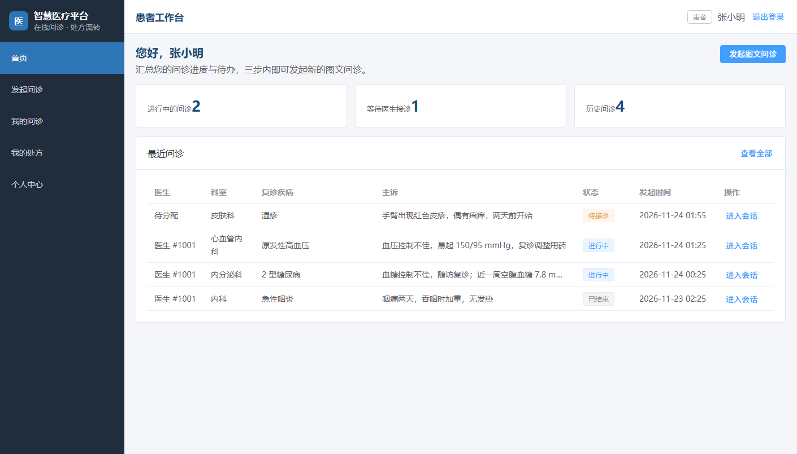

### ③ 发起图文问诊

选择科室、填写复诊疾病与主诉（≥ 5 字），提交后进入会话等待医生接诊。

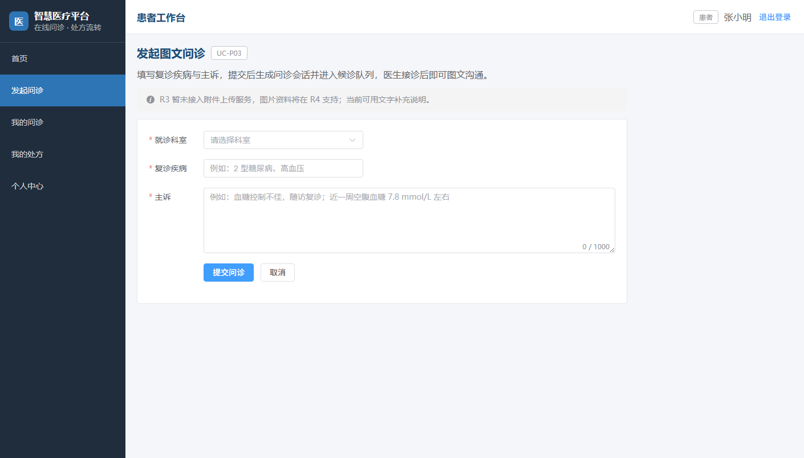

### ④ 患者图文会话

医生接诊后可发送消息；消息 3 秒轮询，发送带 `Idempotency-Key` 去重。

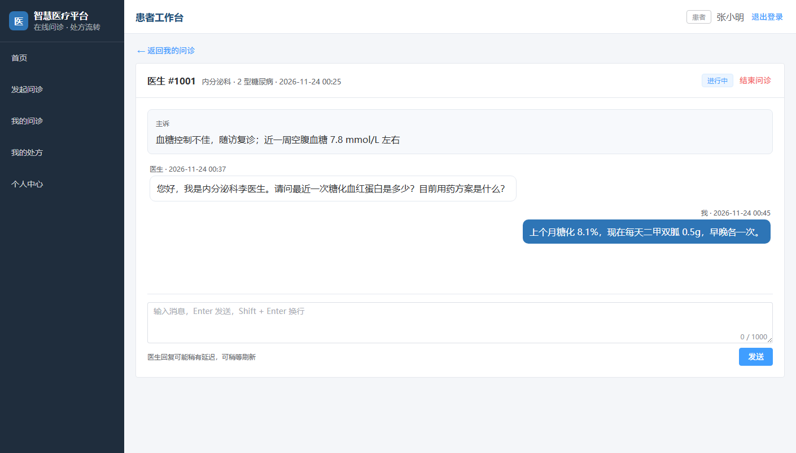

### ⑤ 医生待接诊队列

按等待时长排序；点击“接诊”进入会话（乐观锁防并发接诊）。

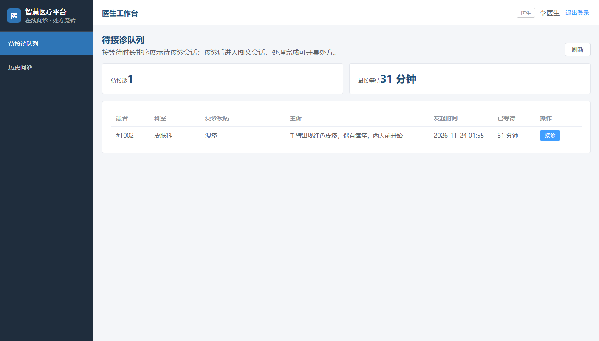

### ⑥ 医生接诊与沟通

查看主诉、回复患者、结束问诊；顶部可直接进入开方工作台。

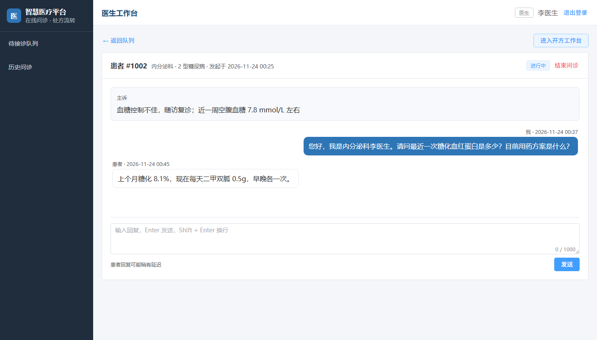

### ⑦ 医生开方

诊断 + 药品明细（≤ 5 条），支持保存草稿、提交审核、撤销；提交后锁定。

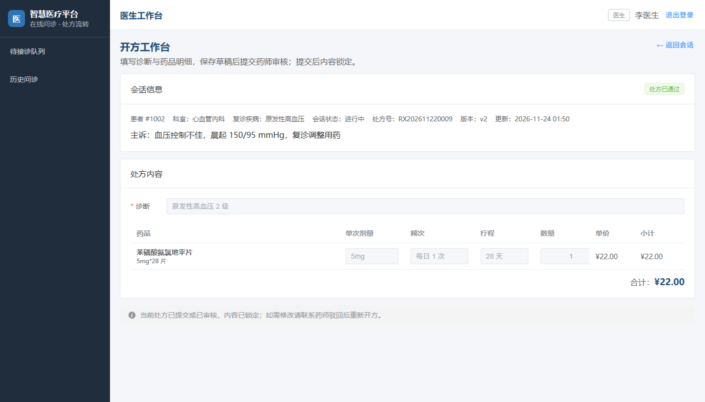

### ⑧ 药师审核

待审队列按提交时间倒序；详情核对明细与金额，通过（电子签名）或驳回（≥ 10 字）。

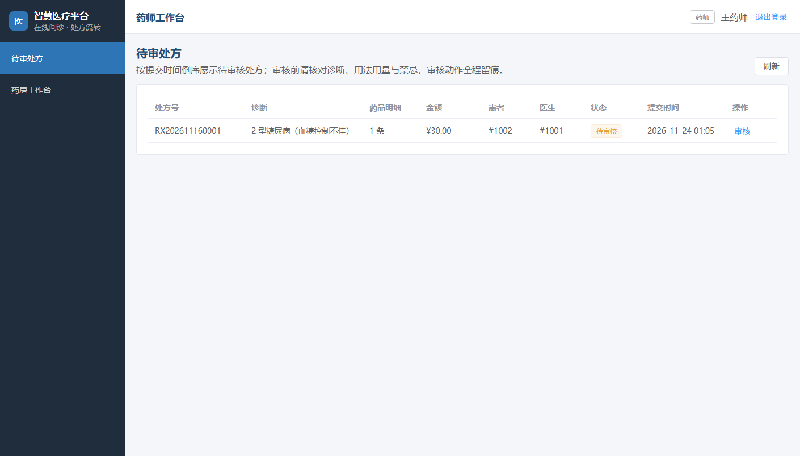

### ⑨ 药房接方与核销

药房工作台分“待接方 / 待核销 / 已核销 / 已拒接”；核销需药品批号 + 取药凭证，幂等键防重复发药。

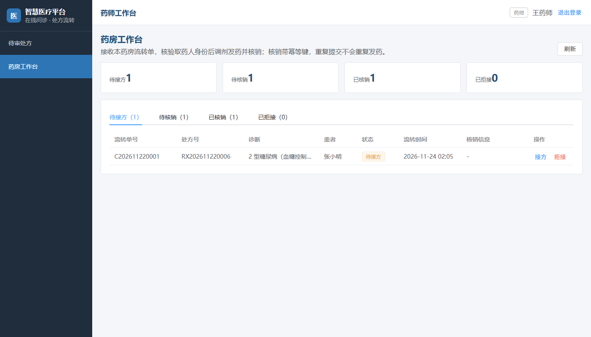

### ⑩ 我的处方

患者查看处方状态（待审核 / 已通过 / 已流转 / 已核销 / 已驳回），不展示医生草稿。

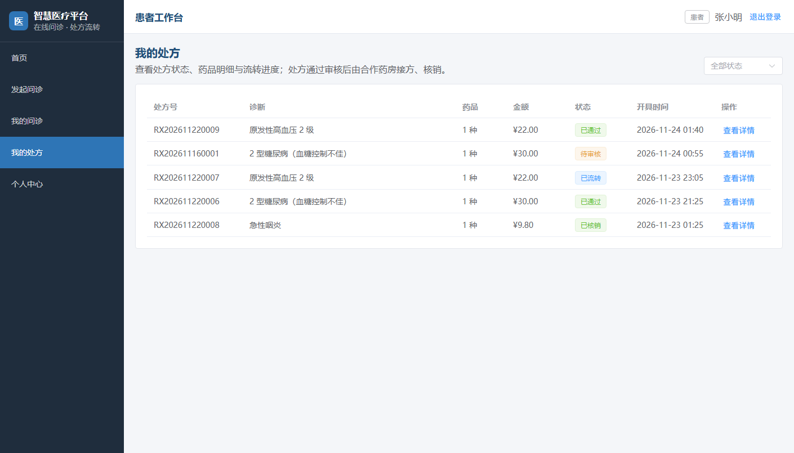

### ⑪ 处方流转追踪

时间线展示“创建 → 提交审核 → 审核通过 → 流转药房 → 核销发药”，核销记录含药品批号。

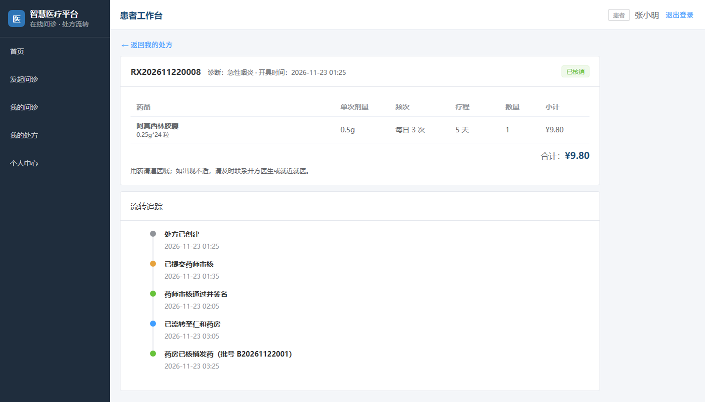

### ⑫ 患者选择药房并流转

审核通过的处方，患者可选合作药房发起流转；随后药房工作台出现“待接方”记录。

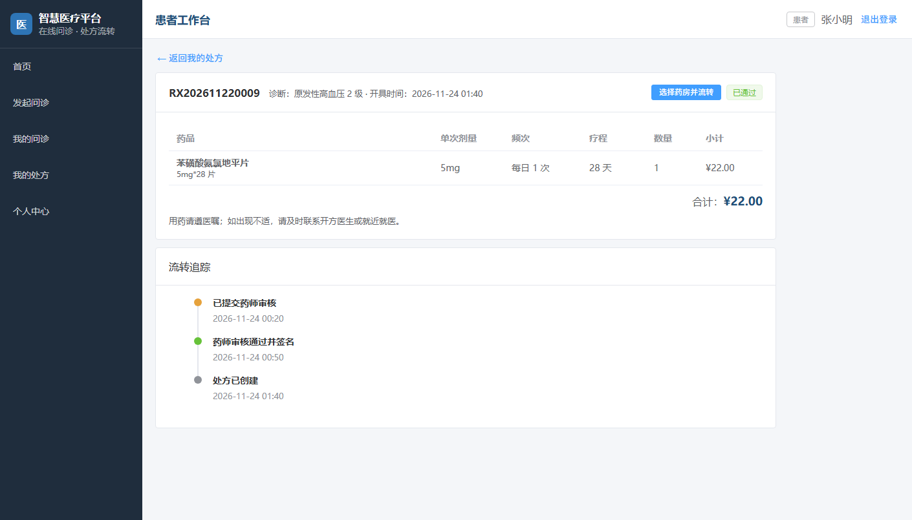

## 3. 截图清单

| 文件 | 页面 | 用例 |
|---|---|---|
| `screenshots/01-login.png` | 登录 | UC-P02 |
| `screenshots/02-patient-home.png` | 患者首页 | UC-P03 |
| `screenshots/03-patient-create.png` | 发起图文问诊 | UC-P03 |
| `screenshots/04-patient-chat.png` | 患者问诊会话 | UC-P04 |
| `screenshots/05-doctor-queue.png` | 医生待接诊队列 | UC-D01 |
| `screenshots/06-doctor-consultation.png` | 医生接诊与沟通 | UC-D02 |
| `screenshots/07-doctor-prescription.png` | 医生开方工作台 | UC-D04 / UC-D05 |
| `screenshots/08-pharmacist-review.png` | 药师待审队列 | UC-H01 |
| `screenshots/09-pharmacist-dispense.png` | 药房工作台 | UC-H05 / UC-F01 / UC-F02 |
| `screenshots/10-patient-prescriptions.png` | 我的处方 | UC-P06 |
| `screenshots/11-patient-trace.png` | 处方流转追踪 | UC-P06 |
| `screenshots/12-patient-circulate.png` | 选择药房并流转 | UC-P06 |

## 4. 已知边界

- 附件上传、医保/支付、真实药房对接未在 v1 范围内；开方页药品目录为演示数据，待目录服务接入后替换。
- 管理端仍为 R2 页面骨架，不在本次演示主链路中。
- mock 数据仅用于演示，重启 mock 后恢复初始种子；真实环境请使用后端与数据库。
