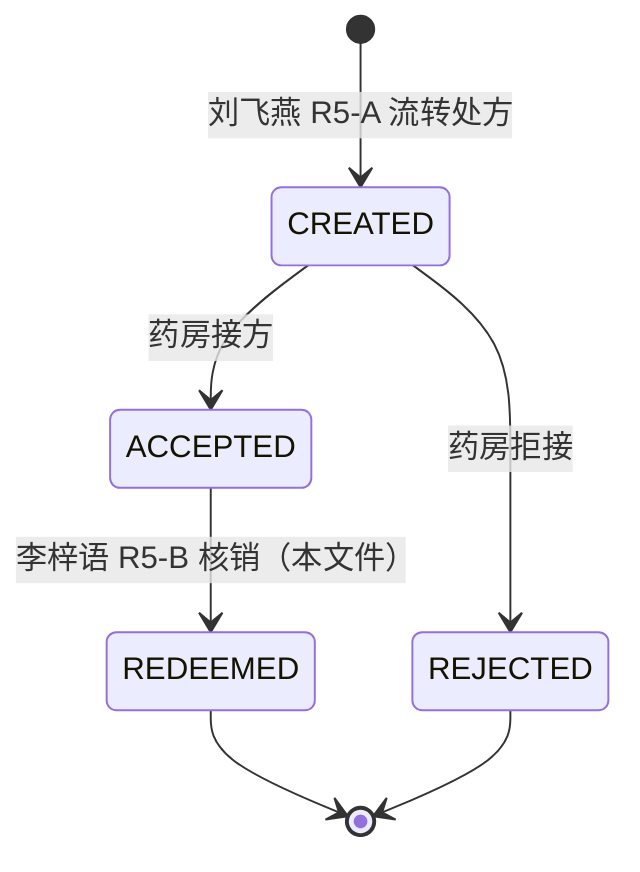

# 处方流转核销模块设计与实现说明（Redeem · R5-B）

| 项目 | 内容 |
|---|---|
| 版本 | v1.0 |
| 更新日期 | 2026-11-22 |
| 负责人 | 李梓语（问诊域、处方域） |
| 对应轮次 | 第 5 轮：流转、核销与部署 |
| 对应提交 | `feat(redeem): add idempotent redeem API [R5][李梓语]` |
| 上游依赖 | 刘飞燕（R5-A）：流转单创建与药房接方；魏宇佳（R5-E）：`circulation_order` / `dispense_record` / `idempotency_record` 建表与部署 |
| 下游依赖 | 代香晰（R5-C）：药师核销页与患者处方追踪；郝佳鑫（R5-D）：重放、并发、越权用例；班国勇（R5-F）：发布说明 |
| 依据文档 | `docs/test/circulation-idempotency-cases.md`（CI-01~CI-11、ST-12~ST-16）、`docs/design/api-contract.md` §3.7 与 §5.5、`database/schema.sql` §8 与 §10.3 |

## 1 目标与范围

第 5 轮核销域交付“药房接方后核销发药，并把处方状态回写为已核销”的闭环：

- 核销：`circulation_order.status` 从 `ACCEPTED` 迁移到 `REDEEMED`，同时把 `prescription.status` 从 `CIRCULATED` 回写为 `REDEEMED`；
- 发药记录：每次成功核销追加一条 `dispense_record`，记录操作药师、药品批号、核验凭证与核销时间；
- 幂等：`POST /circulations/{id}/redeem` 强制携带 `Idempotency-Key`；同一 key 重试返回首次结果，不重复发药；
- 并发：同一流转单只允许一次成功核销，数据库唯一键兜底；
- 追踪：`GET /prescriptions/{id}/trace` 返回处方全链路时间线，供患者端与药师端展示。

不在本轮范围：流转单创建与药房接方（刘飞燕，R5-A）、药房拒接、库存扣减与真实药品主数据、核销短信通知（后续迭代）。核销实现只读取 R5-A 的流转单，不重复实现接方逻辑。

## 2 代码结构

| 分层 | 文件 | 职责 |
|---|---|---|
| 接口层 | `circulation/interfaces/CirculationController.java` | `POST /api/v1/circulations/{id}/redeem`，只做参数绑定 |
| 接口层 | `circulation/interfaces/PrescriptionTraceController.java` | `GET /api/v1/prescriptions/{id}/trace` |
| 接口层 | `circulation/interfaces/dto/RedeemRequest.java` | `batchNo`（可选）、`evidence`（可选） |
| 接口层 | `circulation/interfaces/CirculationExceptionHandler.java` | 统一 `code + detail` 错误体 |
| 应用层 | `circulation/application/CirculationRedeemAppService.java` | 核销编排、幂等重放、权限与药房范围、轨迹组装 |
| 应用层 | `circulation/application/CirculationView.java` / `DispenseView.java` | 与前端 `frontend/src/api/circulation.ts` 对齐的响应 |
| 应用层 | `circulation/application/PrescriptionTraceView.java` | 轨迹响应（`prescriptionId / status / events`） |
| 领域层 | `circulation/domain/CirculationOrder.java` | 流转单聚合，核销状态迁移与版本递增 |
| 领域层 | `circulation/domain/CirculationStatus.java` | `CREATED / ACCEPTED / REDEEMED / REJECTED` |
| 领域层 | `circulation/domain/DispenseRecord.java` | 发药记录值对象，批号与凭证校验 |
| 领域层 | `circulation/domain/IdempotencyRecord.java` | 幂等记录值对象与唯一键语义 |
| 领域层 | `circulation/domain/CirculationRepository.java` / `IdempotencyRepository.java` | 仓储端口 |
| 基础设施 | `circulation/infrastructure/persistence/` | 三张表的 PO 与 MyBatis 仓储实现 |
| 基础设施 | `circulation/infrastructure/mapper/` | MyBatis-Plus Mapper 与药师药房查询 |

依赖方向保持“接口 → 应用 → 领域 ← 基础设施”。处方状态迁移仍只调用处方聚合的 `Prescription.redeem(now)`，核销域不直接改 `prescription.status`。

## 3 接口实现清单

| 方法 | 路径 | 允许角色 | 成功状态码 | 说明 |
|---|---|---|---|---|
| POST | `/api/v1/circulations/{id}/redeem` | 药师（本药房） | 200 | 核销发药；`Idempotency-Key` 必填；返回流转单视图并附 `dispenseRecord` |
| GET | `/api/v1/prescriptions/{id}/trace` | 患者本人 / 开方医生 / 本药房药师 / 管理员 | 200 | 全链路时间线，按业务发生顺序返回 |

核销请求示例：

```http
POST /api/v1/circulations/1001/redeem
Authorization: Bearer <JWT>
Idempotency-Key: 6f1c2a9e-4b7d-4f2a-9c1e-2d8b7a6f5e4d
Content-Type: application/json

{ "batchNo": "B20261122-01", "evidence": "PICKUP-123456" }
```

成功响应（节选）：

```json
{
  "id": 1001,
  "circulationNo": "C202611220001",
  "rxId": 501,
  "pharmacyId": 1,
  "status": "REDEEMED",
  "redeemedAt": "2026-11-22T20:15:30",
  "version": 3,
  "dispenseRecord": {
    "id": 88,
    "batchNo": "B20261122-01",
    "evidence": "PICKUP-123456",
    "operatorId": 4,
    "redeemedAt": "2026-11-22T20:15:30"
  }
}
```

`batchNo` 省略时由服务端生成 `AUTO-<circulationNo>`：既满足 `dispense_record.batch_no NOT NULL`，又能在演示环境追溯；正式接入药品主数据后由药房扫码传入真实批号。

## 4 状态机与不变量



| 编号 | 不变量 | 落点 | 违反时 |
|---|---|---|---|
| I-09 | 只有 `ACCEPTED` 可核销 | `CirculationStatus.canRedeem` + `CirculationOrder.redeem` | 409 `CIRC_STATE_INVALID` |
| I-10 | 一张流转单最多一条发药记录 | `dispense_record.uk_dispense_circ` + 事务内行锁 | 409 `RX_ALREADY_REDEEMED` / 唯一键兜底 |
| I-11 | 核销必须回写处方为 `REDEEMED`，且处方原状态为 `CIRCULATED` | `Prescription.redeem` + `updateHeader` | 409 `CIRC_STATE_INVALID` / `RX_VERSION_CONFLICT` |
| I-12 | 同一幂等键只成功一次，且响应一致 | `idempotency_record.uk_idem` + 请求摘要 | 409 `IDEMPOTENCY_CONFLICT` |
| I-13 | 药师只能核销本药房流转单 | `pharmacist_profile.pharmacy_id` 与 `circulation_order.pharmacy_id` 比对 | 403 `RX_SCOPE_DENIED` |

并发路径：核销事务先对流转单执行 `SELECT ... FOR UPDATE`，再复查幂等记录与状态；两个线程同时核销时后到者会在行锁上等待，前者提交后它看到 `REDEEMED` 或幂等记录，分别返回 409 或回放首次结果。数据库唯一键 `dispense_record.uk_dispense_circ` 是最后一道兜底。

## 5 幂等设计（核心）

### 5.1 三层防线

| 层 | 机制 | 作用 |
|---|---|---|
| 1 | 事务外查 `idempotency_record` | 已成功的重试快速返回，不进入事务 |
| 2 | 事务内 `SELECT ... FOR UPDATE` + 加锁后复查 | 串行化同一流转单的并发核销，后到者走重放 |
| 3 | `idempotency_record.uk_idem`、`dispense_record.uk_dispense_circ` | 任何实现漏洞下的数据库最终兜底 |

### 5.2 key 与请求摘要

- `Idempotency-Key` 由客户端生成（UUID），同一动作重试必须复用；长度 8~64，缺失返回 400 `IDEMPOTENCY_KEY_REQUIRED`；
- 记录唯一键为 `(biz_type='REDEEM', biz_id=circulationId, operation='REDEEM', idem_key)`；
- `request_hash = SHA-256(circulationId | batchNo | evidence)`：同 key 同参数回放首次响应，同 key 换参数返回 409 `IDEMPOTENCY_CONFLICT`；
- `response_snapshot` 保存首次响应 JSON，重放直接反序列化；快照损坏时退回按库重建，保证重放仍可用；
- 记录与核销业务同事务写入，失败一起回滚，不会出现“已发药但幂等记录缺失”。

### 5.3 幂等判定表

| 场景 | 期望 |
|---|---|
| 同 key 重复调用 | 200，返回首次 `dispenseRecord.id`，`dispense_record` 不增加 |
| 同 key 不同参数 | 409 `IDEMPOTENCY_CONFLICT`，无写库 |
| 换 key 重复核销 | 409 `RX_ALREADY_REDEEMED`，`dispense_record` 不增加 |
| 缺 key | 400 `IDEMPOTENCY_KEY_REQUIRED`，无写库 |
| 两线程同 key | 两个 200，`dispense_record = 1` |
| 两线程不同 key | 一个 200、一个 409，`dispense_record = 1` |

## 6 权限与数据范围

| 角色 | 核销 | 处方轨迹 | 说明 |
|---|---|---|---|
| 药师（本药房） | ● | ● | 必须存在 `pharmacist_profile` 且药房与流转单一致 |
| 药师（他药房） | －（403 `RX_SCOPE_DENIED`） | －（403 `RX_SCOPE_DENIED`） | 以 `pharmacist_profile.pharmacy_id` 判定 |
| 医生 | －（403 `SCOPE_DENIED`） | 仅本人开具（403 `RX_SCOPE_DENIED`） | 角色取自 JWT |
| 患者 | －（403 `SCOPE_DENIED`） | 仅本人处方（403 `RX_SCOPE_DENIED`） | 不暴露他人处方流转信息 |
| 管理员 | －（403 `SCOPE_DENIED`） | ●（只读） | 管理员不参与发药 |

前端隐藏“核销”按钮不构成安全边界：角色与资源归属均在服务端二次校验（NFR-SEC-03）。

## 7 数据表

本轮**不新增表**，使用魏宇佳在 `database/schema.sql` 已定义的结构，并同步到 `backend/src/test/resources/schema-test.sql`：

| 表 | 本轮用途 | 关键约束 |
|---|---|---|
| `circulation_order` | 读取接方状态、行锁、回写核销状态与时间 | `uk_circ_no`、`uk_rx`、`uk_idem`、`version` |
| `dispense_record` | 追加发药记录 | `uk_dispense_circ`（一单一条）、`batch_no` 非空 |
| `idempotency_record` | 保存幂等键、请求摘要与首次响应 | `uk_idem (biz_type,biz_id,operation,idem_key)` |
| `pharmacist_profile` | 药师所属药房，做数据范围校验 | `uk_pharmacist_user`、`pharmacy_id` |
| `prescription` | 核销回写 `status=REDEEMED` | 复用 `PrescriptionRepository.updateHeader` 的版本条件更新 |

**交接魏宇佳（R5-E）**：`database/migrations/` 目前只有 `V002`、`V003`、`V004`，请在 `V005__circulation.sql` 固化上述三张表与索引，并在 `database/seed.sql` 中给演示药师补 `pharmacist_profile`（含 `pharmacy_id`），否则演示账号核销会被 403 拦截。

## 8 错误码

| HTTP | `code` | 场景 |
|---|---|---|
| 400 | `IDEMPOTENCY_KEY_REQUIRED` | 核销未携带 `Idempotency-Key` |
| 400 | `IDEMPOTENCY_KEY_INVALID` | key 长度不在 8~64 |
| 400 | `BAD_REQUEST` | `{id}` 非数字、JSON 结构非法 |
| 403 | `SCOPE_DENIED` | 患者/医生/管理员调用核销 |
| 403 | `RX_SCOPE_DENIED` | 药师无档案、跨药房核销、越权查看轨迹 |
| 404 | `CIRC_NOT_FOUND` | 流转单不存在 |
| 404 | `RX_NOT_FOUND` | 流转单关联的处方不存在 |
| 409 | `CIRC_STATE_INVALID` | 未接方核销、处方非 `CIRCULATED` |
| 409 | `RX_ALREADY_REDEEMED` | 换新 key 重复核销 |
| 409 | `IDEMPOTENCY_CONFLICT` | 同一 key 对应不同参数 |
| 409 | `IDEMPOTENCY_IN_PROGRESS` | 幂等记录非 `SUCCESS`（防御性分支） |
| 409 | `CIRC_VERSION_CONFLICT` / `RX_VERSION_CONFLICT` | 流转单/处方被并发修改 |
| 422 | `CIRC_BATCH_INVALID` / `CIRC_EVIDENCE_INVALID` | 批号为空或超长、凭证超长 |

## 9 验证记录

环境：Temurin/OpenJDK 17.0.21 + Maven 3.9.16，H2 内存库（MySQL 兼容模式），`spring.profiles.active=test`。

```text
mvn -B -ntp test
Tests run: 68, Failures: 0, Errors: 0, Skipped: 0
BUILD SUCCESS

  - CirculationIdempotencyTest: 13 例（本轮启用，全部通过）
  - PrescriptionStateTest: 17 例（郝佳鑫 R5 启用，通过）
  - AuthTest 12 例、ConsultationTest 10 例、PrescriptionApiTest 4 例、
    PrescriptionReviewTest 5 例、PrescriptionAggregateTest 7 例（回归通过）
```

覆盖点：

- 正向核销：返回 `REDEEMED`，`dispense_record` 恰好一条，处方状态回写 `REDEEMED`；
- 同 key 重放：返回首次记录 ID，发药记录不增加；
- 换 key 重复核销：409 `RX_ALREADY_REDEEMED`；
- 并发同 key / 异 key：只落一条发药记录；
- 缺 key：400 `IDEMPOTENCY_KEY_REQUIRED`，零副作用；
- 未接方核销：409 `CIRC_STATE_INVALID`；
- 越权：患者 403 `SCOPE_DENIED`、他药房 403 `RX_SCOPE_DENIED`、他人轨迹 403 `RX_SCOPE_DENIED`；
- 未认证：接方/核销/轨迹一律 401，不进入幂等逻辑。

## 10 交接事项

| 对象 | 事项 |
|---|---|
| 刘飞燕（R5-A） | 流转单创建需写 `idempotency_key`（`uk_idem`）与 `circulated_at`；接方置 `ACCEPTED`、`accepted_at`、`version+1`；本模块只读这些字段 |
| 代香晰（R5-C） | 核销请求体为 `{batchNo, evidence}`，响应为 `CirculationOrder`（含 `dispenseRecord`）；`trace` 返回 `{prescriptionId,status,events[]}`，`events[].status` 复用处方/流转状态名 |
| 郝佳鑫（R5-D） | `CirculationIdempotencyTest` 已启用并补齐 `givenOrder` 前置数据；`schema-test.sql` 已加三张表与药师档案 |
| 魏宇佳（R5-E） | 见 §7 的 `V005__circulation.sql` 与 `seed.sql` 药师档案要求 |
| 班国勇（R5-F） | 发布说明需写明“核销强制 `Idempotency-Key`”与新增错误码，避免前端按旧语义处理 409 |

## 11 AI 使用与人工修改

本轮使用 DeepSeek Harness（DeepSeek 模型）辅助生成领域/应用/基础设施/接口四层初稿、H2 表结构与文档骨架。人工核对并修改：

- 把幂等从“先插 PROCESSING 再更新”改为“同事务末尾写 SUCCESS”，避免崩溃留下卡死的占位记录；
- 增加事务内加锁后复查，保证并发同 key 两个请求都返回 200 而不是一个 409；
- 药师药房范围改为必须存在 `pharmacist_profile`，避免“无档案即放行”的漏洞；
- 批号允许省略并生成 `AUTO-<流转单号>`，兼容郝佳鑫用例只传 `evidence` 的请求体；
- 处方状态回写复用 `Prescription.redeem` 与 `updateHeader`，不在核销域直接改状态。

详见 `docs/ai-usage.md` 2026-11-22 记录。
