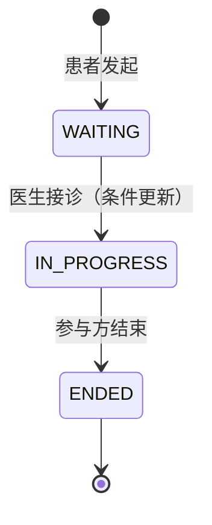

# 图文问诊模块设计与实现说明（Consultation · R3-B）

| 项目 | 内容 |
|---|---|
| 版本 | v1.0 |
| 更新日期 | 2026-11-10 |
| 负责人 | 李梓语（角色 B：问诊域、处方域） |
| 对应轮次 | 第 3 轮：认证与图文问诊 |
| 对应提交 | `feat(consult): add session and message flow [R3][李梓语]` |
| 依据文档 | `docs/design/api-contract.md` v1.0、`backend/src/main/resources/openapi.yaml`、`docs/design/domain-model.md` §5.1/§8.2/§11、`docs/requirements/use-cases.md` UC-P03/P04、UC-D01/D02 |

## 1 目标与范围

第 3 轮问诊域交付“患者发起 → 医生接诊 → 双方收发消息 → 结束会话”的最小闭环，并把权限边界放在服务端：

- 会话生命周期：`WAITING → IN_PROGRESS → ENDED`，状态只能经聚合方法迁移；
- 消息：文本/图片两类，仅参与方可写，会话结束后拒写；
- 越权防护：患者跨会话读取、非接诊医生接诊/写信、非参与方结束一律 403/409；
- 并发接诊：数据库条件更新（`WHERE status='WAITING' AND version=?`）保证同一会话只有一名医生。

不在本轮范围：病历（medical_record）、处方开具（R4）、消息已读回执与 WebSocket 推送（后续迭代）。

## 2 代码结构

| 分层 | 文件 | 职责 |
|---|---|---|
| 接口层 | `consultation/interfaces/ConsultationController.java` | 7 个 REST 端点，只做参数绑定与校验 |
| 接口层 | `consultation/interfaces/dto/ConsultationCreateRequest.java` | 发起问诊请求（`department` / `diseaseName` / `chiefComplaint`） |
| 接口层 | `consultation/interfaces/dto/MessageSendRequest.java` | 发送消息请求（`contentType` / `content`） |
| 接口层 | `consultation/interfaces/ConsultationExceptionHandler.java` | 统一错误体：`code` + 中文 `detail`，422 校验失败、400 格式错误 |
| 应用层 | `consultation/application/ConsultationAppService.java` | 用例编排、数据范围校验、分页归一 |
| 应用层 | `ConsultationView` / `MessageView` / `PageView` | 与 OpenAPI schema 对齐的只读视图 |
| 领域层 | `consultation/domain/ConsultationSession.java` | 聚合根：`open` / `accept` / `end` / `ensureWritable` |
| 领域层 | `ConsultationStatus` / `MessageContentType` / `ConsultationMessage` | 状态与消息值对象 |
| 领域层 | `ConsultationRepository.java` | 仓储端口（含乐观锁条件更新） |
| 领域层 | `ConsultationError` / `ConsultationException` | 领域错误码与业务异常 |
| 基础设施 | `consultation/infrastructure/persistence/*` | MyBatis-Plus PO、Mapper SQL、PO ↔ 领域对象映射 |

依赖方向保持“接口 → 应用 → 领域 ← 基础设施”，领域层不依赖 Spring / MyBatis；接诊与结束的条件更新只在仓储实现中出现。

## 3 接口实现清单

| 方法 | 路径 | 允许角色 | 成功状态码 | 说明 |
|---|---|---|---|---|
| POST | `/api/v1/consultations` | 患者 | 201 | 创建 `WAITING` 会话，`patientId` 取自 JWT，请求体不得指定 |
| GET | `/api/v1/consultations` | 患者/医生/管理员 | 200 | 分页列表；患者看本人、医生看“本人接诊 + 待接诊”、管理员只读全量 |
| GET | `/api/v1/consultations/{id}` | 会话相关方 | 200 | 会话详情，归属校验不通过返回 403 |
| POST | `/api/v1/consultations/{id}/accept` | 医生 | 200 | `WAITING → IN_PROGRESS`，写入 `doctorId`、`startedAt`，`version+1` |
| GET | `/api/v1/consultations/{id}/messages` | 会话相关方 | 200 | 按 `id` 升序分页拉取消息历史 |
| POST | `/api/v1/consultations/{id}/messages` | 患者/接诊医生 | 201 | 追加消息，结束后 409 `SESSION_CLOSED` |
| POST | `/api/v1/consultations/{id}/end` | 患者本人/接诊医生 | 200 | `IN_PROGRESS → ENDED`，写入 `endedAt`，之后只读 |

返回字段严格对齐 `openapi.yaml`：会话 `id / patientId / doctorId / department / diseaseName / chiefComplaint / status / createdAt / endedAt`；消息 `id / consultationId / senderId / senderRole / contentType / content / read / sentAt`；分页 `content / page / size / totalElements / totalPages / last`。

## 4 状态机与不变量



| 编号 | 不变量 | 落点 | 违反时 |
|---|---|---|---|
| I-01 | 只有 `WAITING` 可接诊，一个会话只有一名接诊医生 | `ConsultationSession.accept()` + `compareAndAccept` | 409 `SESSION_ALREADY_ACCEPTED` |
| I-02 | 只有患者本人或接诊医生可发消息；`ENDED`/`ARCHIVED` 后拒绝 | `assertCanWrite()` + `ensureWritable()` | 403 `SCOPE_DENIED` / 409 `SESSION_CLOSED` |
| I-04 | 只有进行中的会话可结束，结束时写入结束时间 | `ConsultationSession.end()` + `compareAndEnd` | 409 `ILLEGAL_STATE` / `SESSION_CLOSED` |

接诊的并发路径：两个医生同时点“接诊”，只有第一条 `UPDATE ... WHERE id=? AND status='WAITING' AND version=?` 影响 1 行，后到者影响 0 行并收到 409，不会覆盖先到者。

## 5 数据范围（越权防护）

| 角色 | 列表范围 | 详情/消息 | 接诊 | 发消息 | 结束 |
|---|---|---|---|---|---|
| 患者 | `patient_id = 本人` | 仅本人 | 禁止（403） | 仅本人会话 | 仅本人会话 |
| 医生 | `doctor_id = 本人 OR status = 'WAITING'` | 本人接诊或待接诊 | 仅 `WAITING` | 仅本人接诊 | 仅本人接诊 |
| 药师 | 禁止（403） | 禁止 | 禁止 | 禁止 | 禁止 |
| 管理员 | 全量只读 | 只读 | 禁止 | 禁止 | 禁止 |

所有归属判断都基于 JWT 解析出的 `CurrentUser.id()`，与请求参数无关；前端隐藏按钮不构成安全边界（对应 NFR-SEC-03）。

## 6 错误码

| HTTP | `code` | 场景 |
|---|---|---|
| 400 | `BAD_REQUEST` | `status` 枚举非法、`page < 0`、`size` 越界、JSON 结构非法 |
| 403 | `SCOPE_DENIED` | 患者访问他人会话、非接诊医生接诊/写信/结束、药师访问问诊接口 |
| 404 | `CONSULTATION_NOT_FOUND` | 会话 ID 不存在 |
| 409 | `SESSION_ALREADY_ACCEPTED` | 会话已被接诊或状态不允许接诊（含并发抢单） |
| 409 | `SESSION_CLOSED` | 会话已结束仍尝试发消息/重复结束 |
| 409 | `ILLEGAL_STATE` | 结束 `WAITING` 会话、结束时会话状态已变化 |
| 422 | `VALIDATION_FAILED` | 科室/疾病/主诉为空、消息内容为空或超长 |

## 7 与数据库的差异（需魏宇佳在 V003 对齐）

`database/schema.sql` 第 1 轮的 `consultation_session` 使用 `department_id`（外键到 `department`），而 v1 契约的请求/响应使用字符串 `department`（`docs/design/api-contract.md` §5.2，前端已按字符串实现）。本轮实现落在契约一侧，`V003__auth_consult.sql` 需要：

1. `consultation_session` 增加 `department VARCHAR(64) NOT NULL`、`disease_name VARCHAR(128) NOT NULL`；或保留 `department_id` 并新增科室字典后由服务端翻译（二选一，需在 V003 说明）；
2. `patient_id` / `doctor_id` 在 v1 直接存 `sys_user.id`（测试库同口径），若坚持外键到 `patient_profile` / `doctor_profile`，需补一层 ID 映射，不能直接复用登录用户 ID；
3. 索引：`idx_session_patient (patient_id, status)`、`idx_session_doctor (doctor_id, status)`、`idx_msg_session (session_id, id)`；
4. 消息表 `read` 为保留字，列名用 `read_flag BOOLEAN`（与实现一致）；
5. `consultation_session.version` 保留，用于接诊/结束的条件更新。

测试库结构见 `backend/src/test/resources/schema-test.sql`，与上述字段一致，可作为 V003 的字段参照。

## 8 验证记录

环境：JDK 17.0.2 + Maven 3.9.9，H2 内存库（MySQL 兼容模式），`spring.profiles.active=test`。

```text
mvn -B -ntp test
Tests run: 22, Failures: 0, Errors: 0, Skipped: 0
  - ConsultationTest: 10 例（发起、接诊、患者越权、重复接诊、跨患者读取、结束后写保护、4 个未认证 401）
  - AuthTest: 12 例
BUILD SUCCESS
```

`ConsultationTest` 原为郝佳鑫在 R3 预置的 6 个 `@Disabled` 业务用例，本轮实现合入后按其注释说明启用，并按 v1 契约把请求字段从草稿态的 `departmentId` / `type` 改为 `department`、`diseaseName`、`contentType`，创建成功断言改为 201。

手工冒烟（可选，需本地 MySQL/Redis）：

```bash
TOKEN=$(curl -s -X POST localhost:8080/api/v1/auth/login \
  -H 'Content-Type: application/json' \
  -d '{"username":"patient01","password":"Passw0rd!"}' | jq -r .accessToken)

curl -s -X POST localhost:8080/api/v1/consultations \
  -H "Authorization: Bearer $TOKEN" -H 'Content-Type: application/json' \
  -d '{"department":"内分泌科","diseaseName":"2 型糖尿病","chiefComplaint":"血糖控制不佳"}'
```

## 9 交接事项

| 对象 | 事项 |
|---|---|
| 代香晰（前端） | `frontend/src/api/consultation.ts` 已按同一契约实现，本轮无需改字段；`POST /consultations` 返回 201，`send` 可用 `Idempotency-Key`（本轮后端未消费该头，R4 补幂等表后启用） |
| 郝佳鑫（测试） | `ConsultationTest` 已启用并全绿；新增用例建议覆盖：并发接诊（两个线程同时 accept 只能成功一个）、`size` 越界 400、空消息 422 |
| 魏宇佳（数据库） | 按第 7 节在 `V003__auth_consult.sql` 对齐 `department` / `disease_name` / `read_flag` 与索引 |
| 刘飞燕（集成） | 问诊接口复用 `CurrentUser` 与 JWT 过滤器，无需改 `SecurityConfig`；`/api/v1/consultations/**` 已在 `anyRequest().authenticated()` 覆盖内 |

## 10 变更记录

| 版本 | 日期 | 变更 | 作者 |
|---|---|---|---|
| v1.0 | 2026-11-10 | 首版：会话、消息、接诊、结束与越权防护实现说明 | 李梓语 |
