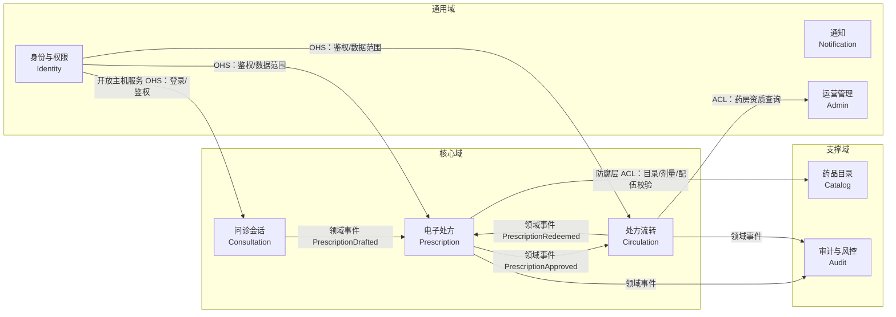
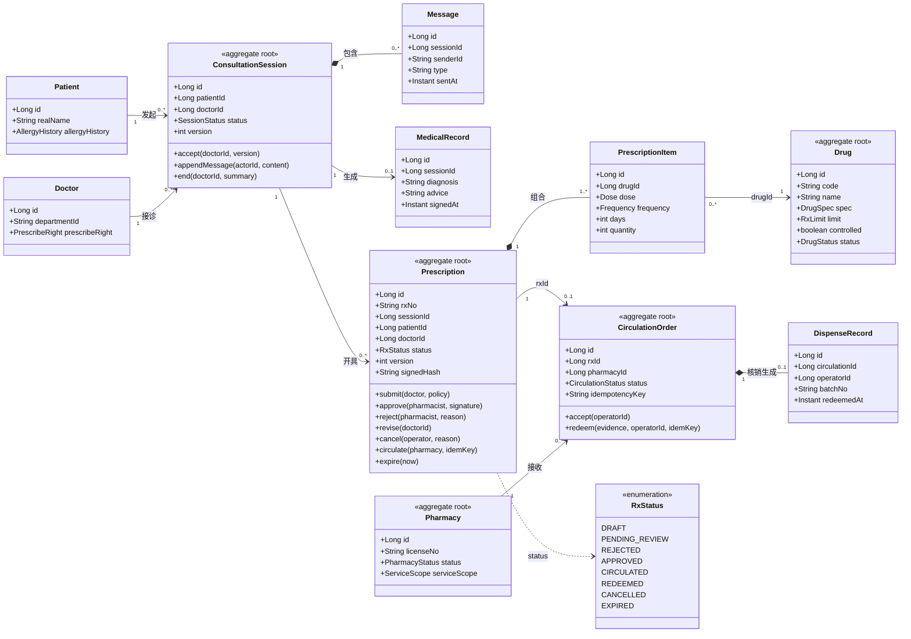
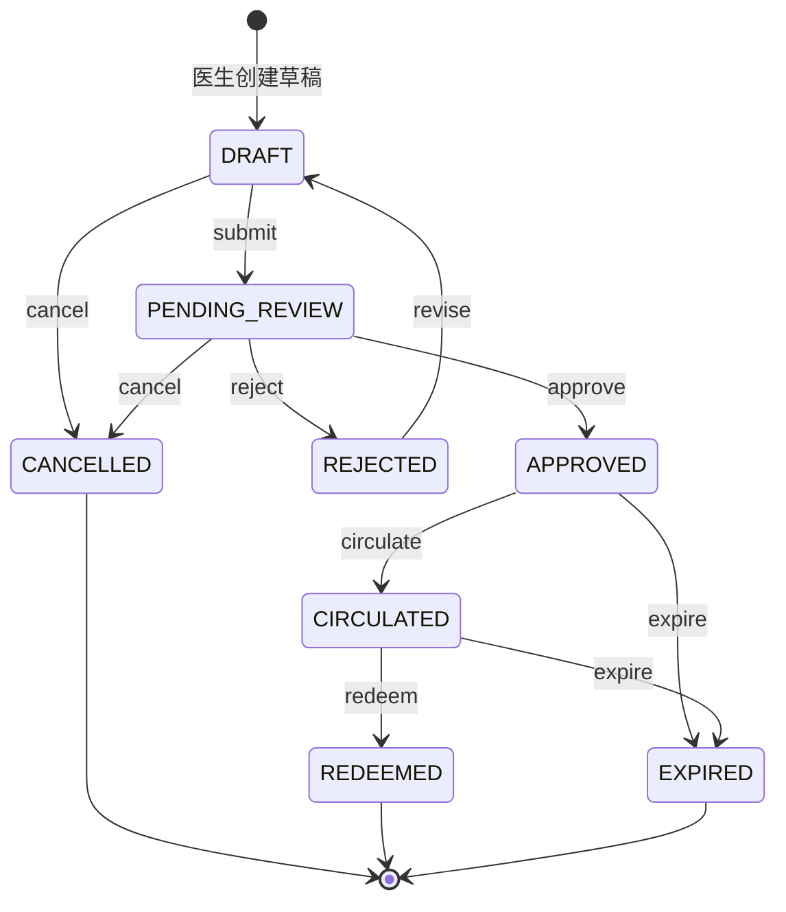

# 领域模型草案（Domain Model Draft）

> 本文档是第 1 轮（R1）设计基线，覆盖聚合根、实体、值对象、聚合间关系与业务不变量。
> 分析模型来自《软件工程实验报告》§3.4 数据建模（表 2-9 CRC 卡片、表 2-10 状态迁移表）；
> 实现约束来自《代码实现方案》§3 核心领域模型。进入编码前（R2）冻结为 v1.0。

| 文档版本 | 更新日期 | 负责人 | 状态 | 关联文档 |
|---|---|---|---|---|
| v0.1 | 2026-11-03 | 郝佳鑫 | 待评审 | `docs/requirements/use-cases.md`（C，R1）、`docs/design/architecture.md`（A，R2）、`docs/design/er.md`（E，R2） |

---

## 1. 目的与范围

本文档回答四个问题，其余内容都围绕它们展开：

1. **系统被切成哪几个聚合**——哪些对象必须一起变、哪些可以各自变；
2. **每个聚合的边界与不变量**——什么规则只能由聚合根保证；
3. **聚合之间怎么连**——只连 ID，还是可以对象导航；
4. **状态怎么流转**——谁能改、改完产生什么事件。

范围：身份与权限、问诊会话、电子处方、处方流转、药品目录、审计六个上下文的**核心领域对象**。
不在本文档范围：页面结构、接口字段细节（见 `docs/design/api-contract.md`）、物理表 DDL（见 `database/schema.sql` 与 `docs/design/er.md`）。

本文档不使用“数据库表驱动”的写法：先有领域对象与不变量，再映射到表，避免把 ER 图直接当成领域模型。

---

## 2. 建模方法与术语

### 2.1 方法

1. **名词短语法**：从用例描述中抽取候选名词（患者、医生、药师、会话、消息、病历、处方、明细、药品、药房、流转单、发药记录、审计、知情同意），合并同义词、剔除纯属性名词。
2. **CRC 分析**：为每个候选类确定“职责 + 协作者”，剔除只有数据没有行为的“贫血表”，得到 10 个核心分析类（实验报告表 2-9）。
3. **聚合收敛**：按“必须同一事务内保持一致”的原则把实体/值对象收进聚合，确定聚合根。
4. **不变量落位**：每条业务规则只允许有一个归属聚合，写进聚合方法而不是 Controller 或定时脚本。

### 2.2 术语

| 术语 | 含义 | 本项目对应 |
|---|---|---|
| 限界上下文 | 业务规则边界，边界内使用统一领域语言 | identity / consultation / prescription / circulation / catalog / audit 等 8 个 |
| 聚合（Aggregate） | 一致性边界，对外只暴露聚合根 | 处方、问诊会话、流转单、药品、药房 |
| 聚合根 | 聚合唯一入口，负责维护不变量 | `Prescription`、`ConsultationSession`、`CirculationOrder`、`Drug`、`Pharmacy` |
| 实体（Entity） | 有标识、生命周期内可变 | `PrescriptionItem`、`Message`、`DispenseRecord` |
| 值对象（Value Object） | 无标识、不可变、整体替换 | `RxStatus`、`Dose`、`DrugSpec`、`RxLimit`、`DispenseEvidence`、`Signature` |
| 领域事件 | 聚合状态变化的事实，用于跨聚合最终一致 | `PrescriptionSubmitted`、`PrescriptionRedeemed` 等 |
| 不变量 | 任何时刻都必须成立、且只能在聚合内校验的规则 | 仅 DRAFT 可编辑、一处方一流转单 |

---

## 3. 限界上下文与领域全景

### 3.1 上下文清单

按《实验报告》表 3-3 划分 8 个限界上下文，其中问诊、处方、流转为核心子域。

| 上下文 | 类型 | 聚合根 | 内部实体/值对象 | 是否本模型重点 |
|---|---|---|---|---|
| Identity 身份与权限 | 通用 | `User` | `Role`、`Permission`、`ConsentRecord`、`DataScope` | 是（授权边界） |
| Consultation 问诊会话 | 核心 | `ConsultationSession` | `Message`、`MedicalRecord`、`SessionStatus` | 是 |
| Prescription 电子处方 | 核心 | `Prescription` | `PrescriptionItem`、`RxStatus`、`Signature`、`RxNo` | 是 |
| Circulation 处方流转 | 核心 | `CirculationOrder` | `DispenseRecord`、`DispenseEvidence`、`CirculationStatus` | 是 |
| Catalog 药品目录 | 支撑 | `Drug` | `DrugSpec`、`RxLimit`、`DrugCategory` | 是 |
| Audit 审计与风控 | 支撑 | `AuditLog` | `AuditAction`、`RiskEvent`、`HashChain` | 是（横切） |
| Notification 通知 | 通用 | `Notification` | `NoticeTemplate`、`SendChannel` | 否（只做事件订阅方） |
| Admin 运营管理 | 通用 | `Pharmacy` | `PharmacyStatus`、`ServiceScope`、`PlatformConfig` | 是（药房资质） |

### 3.2 上下文映射

约定：

- 下游只能通过**应用服务接口**或**事件**访问上游，禁止跨上下文直接查表；
- 对药品目录、药房资质这类外部上下文，用**防腐层（ACL）**做本地快照/翻译，处方聚合只认 `drugId`、`pharmacyId` 与校验结果；
- 审计不反查业务表，只接收事件与动作描述。

---

## 4. 聚合总览

### 4.1 聚合清单

| # | 聚合根 | 内部实体 / 值对象 | 关键不变量 | 主要状态 | 事务边界 |
|---|---|---|---|---|---|
| 1 | `ConsultationSession` | `Message`、`MedicalRecord`、`SessionStatus` | 仅参与方可读写消息；`ENDED`/`CANCELLED` 后不可再发；同一会话同时只有一名接诊医生 | `WAITING → IN_PROGRESS → ENDED / CANCELLED` | 单聚合 |
| 2 | `Prescription` | `PrescriptionItem`、`RxStatus`、`Signature`、`RxNo`、`Version` | 仅 `DRAFT` 可编辑；`APPROVED` 后内容锁定；明细非空才可提交；状态只能经聚合方法迁移 | 8 状态（见 §8.1） | 单聚合 + 同事务写审计与 outbox |
| 3 | `CirculationOrder` | `DispenseRecord`、`DispenseEvidence`、`CirculationStatus`、`IdempotencyKey` | 一张处方最多一张流转单；核销幂等；核销必须携带有效凭证且在有效期内 | `CREATED → ACCEPTED → REDEEMED / REJECTED` | 单聚合 |
| 4 | `Drug` | `DrugSpec`、`RxLimit`、`DrugCategory` | 停用药品不可新增到处方；特殊管理药品禁止进入互联网处方 | `ACTIVE / SUSPENDED` | 单聚合 |
| 5 | `Pharmacy` | `PharmacyStatus`、`ServiceScope`、`AccessKey` | 资质无效不可接方；服务范围决定可接科室/药品 | `PENDING / ACTIVE / SUSPENDED` | 单聚合 |
| 6 | `User` | `RoleAssignment`、`ConsentRecord`、`DataScope` | 角色与数据范围变更即时生效；未签署当前版本知情同意不可发起问诊 | `ENABLED / DISABLED` | 单聚合 |
| 7 | `AuditLog` | `AuditAction`、`HashChain` | 只追加、不可改；哈希链可校验；保留 ≥ 6 个月 | 无状态（追加） | 直接写入，独立表 |
| 8 | `OutboxEvent` / `IdempotencyRecord` | 事件载荷、`(bizType,bizId,operation,key)` | 与业务数据同事务写入；重复键返回首次结果 | `NEW / SENT / FAILED` | 与业务聚合同事务 |

### 4.2 聚合划分原则

1. **一个聚合一个事务**：聚合内部强一致，跨聚合只保证最终一致（领域事件 + 事务发件箱）。
2. **对外只暴露聚合根**：仓库（Repository）只针对聚合根定义，`PrescriptionItem` 没有独立仓库。
3. **跨聚合只存 ID**：`Prescription.sessionId`、`Prescription.doctorId`、`CirculationOrder.rxId` 均为 ID 引用，不做对象导航，避免一次保存牵动多个聚合。
4. **小聚合优先**：能不放进同一个聚合的就不放。病历之所以从会话聚合中拆出（见 §13 问题 1），是因为病历一旦签署即不可修改，与会话的“持续追加消息”语义冲突。
5. **规则跟着数据走**：剂量校验、目录校验属于处方聚合与 `DrugPolicyService`，不属于 Controller；权限点属于 `PermissionEvaluator`，但“处方归属药房”的校验必须回到处方/流转聚合执行，防止 IDOR。

---

## 5. 核心聚合详解

### 5.1 ConsultationSession（问诊会话聚合根）

**职责**：维护会话生命周期、参与方与时序；接诊、结束并释放病历/处方入口。

| 属性 | 类型 | 说明 |
|---|---|---|
| `id` | `SessionId` | 会话标识（雪花 ID） |
| `patientId` | `PatientId` | 发起人（ID 引用） |
| `doctorId` | `DoctorId?` | 接诊后写入；`WAITING` 时为空 |
| `status` | `SessionStatus` | 值对象，4 态 |
| `chiefComplaint` | `String` | 主诉，1–1000 字 |
| `startedAt` / `endedAt` | `Instant?` | 接诊/结束时间 |
| `version` | `int` | 乐观锁，并发接诊控制 |
| `messages` | `List<Message>` | 聚合内实体，按 `sentAt` 有序 |

**方法**：`accept(doctorId, version)`、`appendMessage(actorId, content, clientMsgId)`、`end(doctorId, summary)`、`cancel(reason, operator)`。

**不变量**

- I-01 只有 `WAITING` 状态可接诊，且一名会话只能被一名医生接诊（乐观锁 + 唯一条件更新）；
- I-02 只有 `patientId` 或 `doctorId` 可以追加消息；`ENDED`/`CANCELLED` 后拒绝（`SESSION_CLOSED`）；
- I-03 消息按客户端 `clientMsgId` 去重，重发返回首次结果；
- I-04 `ENDED` 必须由接诊医生发起，并写入结束时间。

**领域事件**：`SessionCreated`、`SessionAccepted`、`SessionEnded`、`SessionCancelled`。

### 5.2 Prescription（处方聚合根）

系统最复杂的聚合，是状态机的唯一入口。**控制器不得直接修改 `status`**。

| 属性 | 类型 | 说明 |
|---|---|---|
| `id` | `PrescriptionId` | 处方标识 |
| `rxNo` | `RxNo` | 处方编号值对象：`RX + yyyyMMdd + 6 位序列`，唯一 |
| `sessionId` | `SessionId` | 绑定会话（ID 引用） |
| `patientId` / `doctorId` | `PatientId` / `DoctorId` | 冗余快照，便于按医生、患者查询 |
| `status` | `RxStatus` | 8 状态值对象 |
| `items` | `List<PrescriptionItem>` | 1–N 条明细，仅 `DRAFT` 可增删改 |
| `signedHash` | `Signature?` | 审核通过后写入的签名摘要（SHA-256） |
| `version` | `int` | 乐观锁；每次迁移 +1 |
| `validUntil` | `Instant` | 有效期（默认签发后 72 小时） |
| `lastRejectReason` | `String?` | 驳回理由，`revise` 时保留，重新提交后归档 |

**方法**（对应表 2-10 的事件）

| 方法 | 守卫 | 结果 |
|---|---|---|
| `addItem(drugId, dose, frequency, days, quantity)` | `status == DRAFT`；药品有效且非特殊管理 | 追加明细并重算数量 |
| `updateItem(itemId, ...)` / `removeItem(itemId)` | `status == DRAFT` | 替换/删除明细 |
| `submit(doctor, policy)` | `status == DRAFT`；明细非空；目录/剂量/配伍/过敏校验通过；医生有处方权 | `PENDING_REVIEW`，锁定内容，`version+1`，发 `PrescriptionSubmitted` |
| `approve(pharmacist, signature)` | `status == PENDING_REVIEW`；药师有 `rx:approve` 且药房匹配 | `APPROVED`，写 `signedHash`，`version+1` |
| `reject(pharmacist, reason)` | `status == PENDING_REVIEW`；理由 ≥ 10 字 | `REJECTED`，保留版本链 |
| `revise(doctorId)` | `status == REJECTED`；操作者为原开方医生 | `DRAFT`，清空审核意见，`version+1` |
| `cancel(operator, reason)` | `status ∈ {DRAFT, PENDING_REVIEW}` | `CANCELLED`（终态） |
| `circulate(pharmacy, idemKey)` | `status == APPROVED`；药房资质有效 | `CIRCULATED`，发 `PrescriptionCirculated` |
| `expire(now)` | `status ∈ {APPROVED, CIRCULATED}` 且超期 | `EXPIRED`（终态） |

**不变量**

- I-05 处方必须绑定有效会话、患者与开方医生，三者不可在创建后变更；
- I-06 仅 `DRAFT` 可编辑；提交后明细锁定，`APPROVED` 后任何内容修改必须“作废重开”；
- I-07 明细药品必须来自当前有效目录，特殊管理药品（麻醉/精神/毒性）禁止进入互联网处方（`RX_CONTROLLED_DRUG`）；
- I-08 明细非空才可提交（`RX_ITEM_EMPTY`）；单次剂量、日剂量、疗程必须在安全区间（`RX_DOSAGE_EXCEEDED`）；
- I-09 审核通过必须由具备权限的药师完成并写入签名摘要，签名为空不得进入 `APPROVED`；
- I-10 状态迁移必须匹配表 2-10，非法迁移统一 `RX_STATE_INVALID`（409），并记录尝试者与当前状态；
- I-11 所有写操作携带 `version`，受影响行数为 0 即版本冲突（409），不得覆盖他人修改。

**领域事件**：`PrescriptionDrafted`、`PrescriptionSubmitted`、`PrescriptionApproved`、`PrescriptionRejected`、`PrescriptionRevised`、`PrescriptionCancelled`、`PrescriptionCirculated`、`PrescriptionExpired`、`PrescriptionRedeemed`。

### 5.3 CirculationOrder（处方流转单聚合根）

**职责**：处方到药房的“一次性交付凭证”。一张处方一张流转单（`uk_rx`），核销必须幂等。

| 属性 | 类型 | 说明 |
|---|---|---|
| `id` | `CirculationId` | 流转单标识 |
| `rxId` | `PrescriptionId` | 处方（ID 引用，唯一） |
| `pharmacyId` | `PharmacyId` | 接收药房 |
| `status` | `CirculationStatus` | `CREATED / ACCEPTED / REDEEMED / REJECTED` |
| `idempotencyKey` | `IdempotencyKey` | 流转与核销去重键（唯一索引） |
| `circulatedAt` / `redeemedAt` | `Instant?` | 关键时间点 |
| `dispenseRecord` | `DispenseRecord?` | 聚合内实体，核销后生成 |

**方法**：`accept(pharmacyOperatorId)`、`reject(reason)`、`redeem(evidence, operatorId, idemKey)`、`toDispenseRecord()`。

**不变量**

- I-12 同一处方只能有一张流转单，重复创建返回已存在的那张（幂等）；
- I-13 核销必须携带 `DispenseEvidence`（取药码或人脸流水）且处方未过期、未核销；重复核销返回首次结果而不是报错（`RX_ALREADY_REDEEMED` 仅用于不同幂等键的第二次核销）；
- I-14 一次核销只生成一条 `DispenseRecord`，写入批次号与操作人，供追溯；
- I-15 只有 `ACCEPTED` 状态可核销；`REJECTED` 是终态，需重新开流转单。

**领域事件**：`CirculationCreated`、`CirculationAccepted`、`CirculationRejected`、`PrescriptionRedeemed`。

### 5.4 Drug（药品目录聚合根）

| 属性 | 类型 | 说明 |
|---|---|---|
| `id` / `code` | `DrugId` / `String` | 标识与目录编码（唯一） |
| `name` / `genericName` | `String` | 商品名 / 通用名 |
| `spec` | `DrugSpec` | 值对象：剂型、规格、单位、包装 |
| `limit` | `RxLimit` | 值对象：单次最大剂量、日最大剂量、最长疗程、单次最大数量 |
| `category` | `DrugCategory` | 分类（抗菌、心血管等） |
| `controlled` | `boolean` | 特殊管理药品标记 |
| `status` | `DrugStatus` | `ACTIVE / SUSPENDED` |

**不变量**：I-16 停用（`SUSPENDED`）药品不可新增到处方，已在草稿中的明细在提交时被校验拦截（`RX_DRUG_UNAVAILABLE`）；I-17 `controlled = true` 的药品禁止互联网开具。

> 说明：药品目录的读多写少，聚合只负责“单个药品的自身合法性”；跨药品的配伍、过敏校验是**领域服务** `DrugPolicyService` 的职责，因为它需要同时读患者档案与多药品规则。

### 5.5 Pharmacy（合作药房聚合根）

| 属性 | 类型 | 说明 |
|---|---|---|
| `id` / `name` / `licenseNo` | `PharmacyId` / `String` / `String` | 标识、名称、经营许可证 |
| `status` | `PharmacyStatus` | `PENDING / ACTIVE / SUSPENDED` |
| `serviceScope` | `ServiceScope` | 值对象：可接科室、可接药品分类、配送方式 |
| `accessKeyRef` | `String` | 接入密钥引用（不落明文） |

**不变量**：I-18 资质非 `ACTIVE` 不可接方（`PHARMACY_INACTIVE`）；I-19 处方药房必须在 `serviceScope` 覆盖范围内，否则转人工或改派。

### 5.6 User / ConsentRecord（身份与授权）

| 对象 | 类型 | 关键规则 |
|---|---|---|
| `User` | 聚合根 | 登录名唯一；密码仅存 Argon2id 哈希；`DISABLED` 立即失效且令牌拉黑 |
| `RoleAssignment` | 聚合内实体 | 一个用户可有多个角色，但**主数据范围唯一**（如“本人”或“本药房”） |
| `ConsentRecord` | 聚合内实体 | 记录隐私政策版本、同意时间、撤回时间；撤回后保留历史，不回删 |
| `DataScope` | 值对象 | `SELF / DEPARTMENT / PHARMACY / ALL`，决定 SQL 追加条件 |

**不变量**：I-20 未签署当前版本知情同意不可发起问诊（`CONSENT_REQUIRED`）；I-21 角色/权限变更即时生效，不依赖重新登录；I-22 管理员不得直接开方或修改处方内容（权限点层面无 `rx:write`）。

### 5.7 横切对象

| 对象 | 归属 | 说明 |
|---|---|---|
| `AuditLog` | 审计上下文 | 只追加；`hashChain = SHA256(prevHash + 本条规范化内容)`；不设业务外键 |
| `OutboxEvent` | 基础设施 | 与业务聚合同事务写入；后台轮询投递；失败指数退避 |
| `IdempotencyRecord` | 基础设施 | 唯一键 `(bizType, bizId, operation, idemKey)`；重复请求回放首次结果 |
| `Notification` | 通知上下文 | 事件订阅方，只接收最小必要字段（不含诊断与明细） |

---

## 6. 实体与值对象目录

### 6.1 实体

| 实体 | 所属聚合 | 标识 | 主要属性 | 可变性 |
|---|---|---|---|---|
| `Message` | `ConsultationSession` | `MessageId` | 发送人、类型（文本/图片）、内容引用、`sentAt`、`clientMsgId` | 追加后不可改，仅可撤回标记 |
| `PrescriptionItem` | `Prescription` | `PrescriptionItemId` | `drugId`、`Dose`、`Frequency`、`days`、`quantity` | 仅 `DRAFT` 可改 |
| `DispenseRecord` | `CirculationOrder` | `DispenseId` | 操作人、批次号、凭证引用、核销时间 | 写入后不可改 |
| `MedicalRecord` | `ConsultationSession`（暂定，见 §13） | `RecordId` | 主诉、诊断、处置建议、签名时间 | 签署后不可改 |

### 6.2 值对象

| 值对象 | 组成 | 不变量 |
|---|---|---|
| `RxStatus` | 8 个枚举常量 | 非法枚举值直接拒绝；与数据库 `VARCHAR(32)` 一一映射 |
| `Dose` | 数量 + 单位（mg/g/ml/片） | 数量 > 0；单位受控；同一条明细单位唯一 |
| `Frequency` | 编码（qd/bid/tid/qid…）+ 每日次数 | 每日次数与编码一致 |
| `DrugSpec` | 剂型、规格、包装单位 | 整体替换，不局部修改 |
| `RxLimit` | 单次/日最大剂量、最长疗程、最大数量 | 上界为正数且 ≥ 下界 |
| `RxNo` | 前缀 + 日期 + 序列 | 全局唯一、不可复用 |
| `Signature` | 摘要 + 签名时间 + 签名人 | 64 位十六进制；`APPROVED` 前必须存在 |
| `DispenseEvidence` | 类型（取药码/人脸流水）+ 摘要 | 核销时必填且未过期 |
| `IdempotencyKey` | 业务类型 + 业务 ID + 操作 + 客户端键 | 长度 ≤ 64；同一组合唯一 |
| `DataScope` | 枚举（本人/科室/药房/全部） | 与角色绑定，越权直接 403 |

> 值对象一律**不可变**：修改即整体替换，避免“绕过聚合方法改半个字段”。

---

## 7. 聚合间关系

### 7.1 关系清单

| 源 | 目标 | 多重性 | 引用方式 | 说明 |
|---|---|---|---|---|
| `Patient` | `ConsultationSession` | 1 : 0..* | ID | 患者发起多个会话 |
| `Doctor` | `ConsultationSession` | 1 : 0..* | ID | 医生接诊多个会话 |
| `ConsultationSession` | `Message` | 1 : 0..* | 聚合内 | 消息属于会话 |
| `ConsultationSession` | `MedicalRecord` | 1 : 0..1 | ID（暂定） | 结束问诊生成一份病历 |
| `ConsultationSession` | `Prescription` | 1 : 0..* | ID | 一次会话可开多张处方 |
| `Prescription` | `PrescriptionItem` | 1 : 1..* | 聚合内 | 组合关系，随处方删除 |
| `PrescriptionItem` | `Drug` | 0..* : 1 | ID | 引用目录药品 |
| `Prescription` | `CirculationOrder` | 1 : 0..1 | ID | 一张处方最多一张流转单 |
| `Pharmacy` | `CirculationOrder` | 1 : 0..* | ID | 药房接收多张流转单 |
| `CirculationOrder` | `DispenseRecord` | 1 : 0..1 | 聚合内 | 核销后生成 |
| `User` | `ConsultationSession` | 1 : 0..* | ID | 参与方账号 |
| `User` | `AuditLog` | 1 : 0..* | ID（弱引用） | 审计不设外键 |

### 7.2 领域类图

> 说明：`*--` 表示聚合内组合（同生命周期），`-->` 表示跨聚合 ID 引用。图中不画数据库外键，外键属于 `docs/design/er.md` 的职责。

### 7.3 引用规则

1. 聚合内部：对象导航，直接调用；
2. 跨聚合：只存 ID + 必要的只读快照（如 `patientId`、`doctorId`）；
3. 需要其他聚合的数据时，通过**应用服务**查询后以参数传入领域方法（`submit(doctor, policy)`），领域层不注入其他聚合的仓库；
4. 需要强一致的跨聚合操作，一律拆成“先改一个聚合 + 发事件，再由订阅方改另一个”，禁止跨聚合事务。

---

## 8. 状态与生命周期

### 8.1 处方状态机（8 状态）

与《实验报告》表 2-10 一致。补充约定：

- `REJECTED` 不是终态，可经 `revise` 回到 `DRAFT`；
- `CANCELLED`、`REDEEMED`、`EXPIRED` 为终态，任何事件都返回 `RX_STATE_INVALID`；
- 过期由定时任务驱动，判定依据是 `validUntil` 而非“最后更新时间”，防止被写操作续期；
- 状态迁移实现为**集中配置表**（`(from, event) → (guard, to, sideEffects)`），不写散落的 `if/else`。

### 8.2 会话与流转状态

| 聚合 | 状态 | 迁移 |
|---|---|---|
| `ConsultationSession` | `WAITING` → `IN_PROGRESS` → `ENDED`；`WAITING/IN_PROGRESS` → `CANCELLED` | 接诊 / 结束 / 取消 |
| `CirculationOrder` | `CREATED` → `ACCEPTED` → `REDEEMED`；`CREATED/ACCEPTED` → `REJECTED` | 接方 / 核销 / 拒方 |
| `Drug` | `ACTIVE` ⇄ `SUSPENDED` | 目录维护（需审计） |
| `Pharmacy` | `PENDING` → `ACTIVE` ⇄ `SUSPENDED` | 资质审核（需审计） |

### 8.3 并发与幂等落位

| 场景 | 机制 | 落位 |
|---|---|---|
| 处方编辑/提交/审核 | 乐观锁 `version` | `Prescription.version`，`UPDATE ... WHERE id=? AND version=?` 影响 0 行即 409 |
| 医生并发接诊 | 条件更新 | `UPDATE session SET doctor_id=?, status='IN_PROGRESS' WHERE id=? AND status='WAITING'` |
| 流转/核销重放 | 幂等键 + 唯一索引 | `IdempotencyRecord` + `circulation_order.uk_idem` |
| 消息重复发送 | 客户端消息 ID 去重 | `Message.clientMsgId` + 会话内唯一 |

---

## 9. 领域事件与一致性

| 事件 | 发布聚合 | 触发时机 | 订阅方 | 一致性 |
|---|---|---|---|---|
| `SessionCreated` | `ConsultationSession` | 创建会话 | 通知、审计 | 异步（outbox） |
| `SessionAccepted` | `ConsultationSession` | 接诊 | 通知 | 异步 |
| `SessionEnded` | `ConsultationSession` | 结束问诊 | 通知、审计 | 异步 |
| `PrescriptionDrafted` | `Prescription` | 创建/编辑草稿 | 无（本地） | — |
| `PrescriptionSubmitted` | `Prescription` | 提交 | 药师待办、通知 | 异步 |
| `PrescriptionApproved` | `Prescription` | 审核通过 | 流转、通知 | 异步 |
| `PrescriptionRejected` | `Prescription` | 驳回 | 医生待办、通知 | 异步 |
| `PrescriptionCirculated` | `Prescription` | 流转 | 药房网关、通知 | 异步（药房调用在 outbox 之后） |
| `CirculationAccepted` | `CirculationOrder` | 药房接方 | 通知、审计 | 异步 |
| `PrescriptionRedeemed` | `CirculationOrder` | 核销 | 处方（置 `REDEEMED`）、审计、通知 | 异步 + 幂等 |
| `PrescriptionExpired` | `Prescription` | 定时扫描超期 | 通知 | 异步 |
| `ConsentWithdrawn` | `User` | 撤回授权 | 通知、风控 | 异步 |

一致性策略：

- **同事务**：聚合状态、明细、审计、outbox 一起提交；
- **最终一致**：跨聚合通过事件驱动，消费者必须幂等（按 `eventId` 去重）；
- **顺序**：同一聚合的事件按 `version` 升序消费，乱序时丢弃旧版本；
- **失败处理**：outbox 指数退避；超过阈值转人工告警，不静默丢弃。

---

## 10. 领域服务

| 领域服务 | 职责 | 为什么不是聚合方法 |
|---|---|---|
| `DrugPolicyService` | 目录有效性、剂量区间、配伍禁忌、过敏冲突、特殊药品校验 | 需要同时读患者过敏史、多药品规则与目录快照，跨多个聚合 |
| `PrescriptionSigner` | 生成审核签名摘要（`signedHash`） | 依赖密钥/算法设施，属技术关注点，聚合只保存结果 |
| `RxNumberGenerator` | 生成唯一处方号 | 依赖序列/雪花设施，聚合只接收 `RxNo` 值对象 |
| `CirculationRouter` | 按科室、药房服务范围与库存选择药房 | 需要查询药房上下文，处方聚合只接受选中的 `pharmacyId` |

> 领域服务不持有事务，由应用服务在事务内调用；领域服务不得反向调用应用服务。

---

## 11. 不变量与错误码映射

| 不变量 | 校验位置 | 错误码 | HTTP |
|---|---|---|---|
| I-05 处方必须绑定有效会话/患者/医生 | `Prescription.create()` | `RX_SESSION_INVALID` | 400 |
| I-06 仅 DRAFT 可编辑 | `Prescription.updateItem()` | `RX_STATE_INVALID` | 409 |
| I-07 药品不在有效目录 | `DrugPolicyService` | `RX_DRUG_UNAVAILABLE` | 400 |
| I-07 特殊管理药品 | `DrugPolicyService` | `RX_CONTROLLED_DRUG` | 400 |
| I-08 明细为空 | `Prescription.submit()` | `RX_ITEM_EMPTY` | 400 |
| I-08 剂量/疗程超限 | `DrugPolicyService` | `RX_DOSAGE_EXCEEDED` | 400 |
| 过敏冲突 | `DrugPolicyService` | `RX_ALLERGY_RISK` | 409（强提醒 + 医生确认） |
| 配伍禁忌 | `DrugPolicyService` | `RX_INTERACTION_RISK` | 409 |
| 医生无处方权 | `DrugPolicyService` | `RX_NO_PRESCRIBE_RIGHT` | 403 |
| I-09 审核权限不足 / 药房不匹配 | `Prescription.approve()` | `RX_REVIEW_DENIED` / `RX_SCOPE_DENIED` | 403 |
| I-10 非法状态迁移 | `PrescriptionStateMachine` | `RX_STATE_INVALID` | 409 |
| I-11 版本冲突 | 仓储条件更新 | `VERSION_CONFLICT` | 409 |
| I-12 重复流转 | `CirculationAppService` | 返回既有 `CirculationOrder` | 200（幂等） |
| I-13 处方已过期 | `CirculationOrder.redeem()` | `RX_EXPIRED` | 409 |
| I-13 已核销（不同幂等键） | `CirculationOrder.redeem()` | `RX_ALREADY_REDEEMED` | 409 |
| I-15 未接方即核销 | `CirculationOrder.redeem()` | `CIRC_STATE_INVALID` | 409 |
| I-18 药房资质无效 | `CirculationOrder.create()` | `PHARMACY_INACTIVE` | 409 |
| I-20 未签署知情同意 | `ConsultationAppService` | `CONSENT_REQUIRED` | 403 |
| 令牌无效/过期 | 安全层 | `TOKEN_INVALID` | 401 |

> 错误码统一由 `platform-common` 的 `ErrorCode` 枚举维护，禁止在各模块自定义字符串。

---

## 12. 追踪关系

### 12.1 聚合 → 用例 → 表 → 接口 → 测试

| 聚合 | 主要用例 | 数据表 | 主要接口 | 计划测试编号 |
|---|---|---|---|---|
| `ConsultationSession` | UC-P03、UC-P04、UC-D01、UC-D02 | `consultation_session`、`consultation_message` | `POST /api/v1/consultations`、`/{id}/accept`、`/{id}/messages` | FT-01、FT-02、ST-03（越权） |
| `MedicalRecord` | UC-D03 | `medical_record` | `POST /api/v1/consultations/{id}/record` | FT-03 |
| `Prescription` | UC-D04、UC-D05、UC-D06、UC-H02、UC-H03、UC-H04 | `prescription`、`prescription_item` | `POST /api/v1/prescriptions/drafts`、`/{id}/submit`、`/{id}/approve`、`/{id}/reject` | SM-01 ~ SM-08、FT-11 ~ FT-19 |
| `CirculationOrder` | UC-H05、F20–F22 | `circulation_order`、`dispense_record` | `POST /api/v1/circulations/{id}/accept`、`/{id}/redeem` | FT-20 ~ FT-22、ST-05（重放） |
| `Drug` | UC-A03、UC-H06 | `drug`、`drug_category` | `GET /api/v1/drugs`、管理端维护 | FT-16 |
| `Pharmacy` | UC-A06 | `pharmacy` | 管理端维护 | FT-25 |
| `User` / `ConsentRecord` | UC-P01、UC-P02、UC-P07 | `sys_user`、`sys_role`、`sys_user_role`、`consent_record` | `POST /api/v1/auth/register`、`/login` | FT-01、ST-01（越权）、ST-02（令牌） |
| `AuditLog` | UC-A04 | `audit_log` | `GET /api/v1/audits` | ST-06（哈希链） |

### 12.2 与数据库的映射原则

- 一个聚合根对应一张主表，内部实体对应子表并带 `聚合根_id` 外键；
- 值对象以列展开（`status`、`dosage`、`dosage_unit`）或组合列（`signed_hash`），不单独建表；
- 跨聚合 ID 在数据库中体现为外键（业务表）或弱引用（审计/事件表无外键）；
- `status` 列只存枚举常量名，与 `RxStatus` 常量一一对应，禁止数字魔法值。

---

## 13. 待确认问题（评审输入）

| # | 问题 | 当前倾向 | 影响 |
|---|---|---|---|
| 1 | `MedicalRecord` 是否独立聚合？ | 倾向独立聚合，`Prescription` 只引用 `sessionId` | 若并入会话聚合，签署后不可改的约束会把整个会话锁死 |
| 2 | 一次会话是否允许多张处方？ | 允许（1:0..*），但同一 `DRAFT` 唯一 | 影响 `uk_session_draft` 唯一索引 |
| 3 | 是否支持“拆方”（一张处方分多个药房）？ | v1 不支持，一张处方一张流转单 | 影响 `CirculationOrder.uk_rx` |
| 4 | 补药/续方是否进入处方聚合？ | v1 不支持，留作扩展事件 | 可能新增 `RenewalRequest` 聚合 |
| 5 | 单张处方明细条数上限？ | 暂定 5 条（医保常见约束），待与需求确认 | 影响校验规则与 UI |
| 6 | 处方有效期 72 小时是否可配置？ | 可配置，按科室/药品分类覆盖 | 影响 `validUntil` 计算位置 |
| 7 | `AuditLog` 是否需要独立数据库连接？ | v1 同库独立表，双人复核留到 R4 | 影响部署与性能 |
| 8 | 患者撤回授权后，历史处方是否可见？ | 可见但仅本人+审计，做匿名化展示 | 影响 `DataScope` 与字段脱敏 |

> 以上问题在 R1 评审会上确认，结论写入 `docs/process/review-01.md`（F），并同步更新本文档与 `docs/design/er.md`。

---

## 14. 变更记录

| 版本 | 日期 | 变更 | 作者 |
|---|---|---|---|
| v0.1 | 2026-11-03 | 初稿：聚合清单、实体/值对象目录、类图与状态机、不变量与错误码映射 | 郝佳鑫 |
