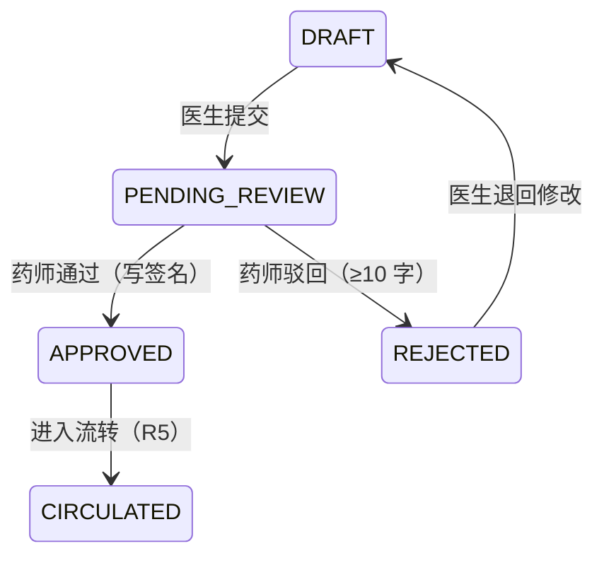

# 药师处方审核模块设计与实现说明（Review · R4-B）

| 项目 | 内容 |
|---|---|
| 版本 | v1.0 |
| 更新日期 | 2026-11-17 |
| 负责人 | 李梓语（问诊域、处方域） |
| 对应轮次 | 第 4 轮：处方、审核与状态机 |
| 对应提交 | `feat(review): add pharmacist approve and reject [R4][李梓语]` |
| 上游依赖 | `feat(rx): add prescription aggregate and state machine [R4][刘飞燕]`（处方聚合与 8 状态机） |
| 依据文档 | `docs/design/api-contract.md` §5.4、`backend/src/main/resources/openapi.yaml` 的 `Review` / `ReviewRequest`、`docs/design/domain-model.md` §8.1/§11、`docs/requirements/use-cases.md` UC-PH01~03 |

## 1 目标与范围

第 4 轮审核域交付“药师取待审队列 → 通过（电子签名）/ 驳回（必填意见）→ 医生与药师追溯审核记录”的闭环：

- 队列：只返回 `PENDING_REVIEW` 处方，按提交先后分页；
- 通过：`PENDING_REVIEW → APPROVED`，写入签名摘要、审核药师、审核时间与 72 小时有效期；
- 驳回：`PENDING_REVIEW → REJECTED`，理由至少 10 个字，医生修改后可重新提交；
- 记录：每次审核追加一条 `prescription_review`，`GET /prescriptions/{id}/reviews` 按时间追溯；
- 权限：只有药师能审核；医生只能看自己处方的记录；患者与管理员不能审核。

不在本轮范围：处方流转（R5）、药房核销（R5）、CA 证书与第三方电子签名服务（以摘要签名替代，见 §6）、审核超时自动提醒（后续迭代）。

本轮**不重复实现**处方聚合与开方链路：状态迁移仍只调用刘飞燕在 R4-A 提供的 `Prescription.approve` / `Prescription.reject`，本模块只补“审核编排、签名、记录与接口”。

## 2 代码结构

| 分层 | 文件 | 职责 |
|---|---|---|
| 接口层 | `prescription/interfaces/PrescriptionReviewController.java` | 4 个 REST 端点，只做参数绑定与校验 |
| 接口层 | `prescription/interfaces/dto/ReviewRequest.java` | 审核意见（`comment` 必填，2~500 字） |
| 应用层 | `prescription/application/PrescriptionReviewAppService.java` | 队列、通过、驳回、记录追溯；角色与数据范围校验 |
| 应用层 | `prescription/application/ReviewView.java` | 与 `Review` schema 对齐的只读视图 |
| 领域层 | `prescription/domain/PrescriptionReview.java` | 审核记录值对象（只追加、不改写） |
| 领域层 | `prescription/domain/ReviewAction.java` | `APPROVED` / `REJECTED` |
| 领域层 | `prescription/domain/ReviewSignature.java` | 电子签名摘要（SHA-256 + Base64URL） |
| 领域层 | `prescription/domain/PrescriptionRepository.java` | 新增 `insertReview` / `findReviews` 两个端口 |
| 基础设施 | `prescription/infrastructure/persistence/PrescriptionReviewPO.java` | `prescription_review` 表映射 |
| 基础设施 | `prescription/infrastructure/mapper/PrescriptionReviewMapper.java` | MyBatis-Plus BaseMapper |
| 基础设施 | `prescription/infrastructure/persistence/MyBatisPrescriptionRepository.java` | 记录落库与按处方查询 |

依赖方向保持“接口 → 应用 → 领域 ← 基础设施”；`PrescriptionExceptionHandler` 的 `assignableTypes` 增加本模块 Controller，错误体与开方链路保持一致（`code` + `detail`）。

## 3 接口实现清单

| 方法 | 路径 | 允许角色 | 成功状态码 | 说明 |
|---|---|---|---|---|
| GET | `/api/v1/prescriptions/review-queue` | 药师 | 200 | 待审队列，固定 `PENDING_REVIEW`，按 id 倒序分页 |
| POST | `/api/v1/prescriptions/{id}/reviews/approve` | 药师 | 200 | 通过：写签名、审核人、审核时间、有效期；`version+1` |
| POST | `/api/v1/prescriptions/{id}/reviews/reject` | 药师 | 200 | 驳回：`comment` 至少 10 字；写驳回理由；不产生签名 |
| GET | `/api/v1/prescriptions/{id}/reviews` | 开方医生、药师、管理员 | 200 | 审核记录列表，按 `id` 升序 |

返回字段严格对齐 `openapi.yaml` 的 `Review`：`id / prescriptionId / pharmacistId / action / comment / signature / signedAt`；队列返回 `PrescriptionPageView`（`content / page / size / total`）。

> 路径细节：`/prescriptions/review-queue` 是字面量路径，Spring 的路径匹配优先于 `/prescriptions/{id}`，不会把 `review-queue` 当成处方 ID；`{id}` 非法时由类型转换异常统一返回 400 `BAD_REQUEST`。

## 4 状态机与不变量



| 编号 | 不变量 | 落点 | 违反时 |
|---|---|---|---|
| I-05 | 只有 `PENDING_REVIEW` 可通过或驳回 | `PrescriptionStatus.canApply` + `Prescription.approve/reject` | 409 `RX_STATE_INVALID` |
| I-06 | 通过必须写入非空签名摘要 | `Prescription.approve` + `PrescriptionReview` 构造校验 | 422 `RX_SIGNATURE_REQUIRED` |
| I-07 | 驳回理由至少 10 个字 | `Prescription.reject` | 422 `RX_REJECT_REASON_INVALID` |
| I-08 | 同一次审核只产生一条记录，且不可改写 | 应用层事务 + `insertReview` 只增 | 重复审核被状态机拦截（409） |

并发路径：两位药师同时审同一张处方时，服务先取迁移前 `version`，通过 `UPDATE ... WHERE id=? AND version=?` 条件更新；只有一方影响 1 行，另一方影响 0 行并得到 409 `RX_VERSION_CONFLICT`，不会写出两条互相矛盾的审核记录。

## 5 数据范围与权限

| 角色 | 待审队列 | 通过/驳回 | 审核记录 |
|---|---|---|---|
| 药师 | ● | ● | ● |
| 医生 | －（403） | －（403） | 仅本人开具 |
| 患者 | －（403） | －（403） | －（403） |
| 管理员 | －（403） | －（403） | ●（只读监管） |

角色一律取自 JWT 解析出的 `CurrentUser.roleCode()`，资源归属由服务端二次校验；前端隐藏“审核”按钮不构成安全边界（NFR-SEC-03）。

## 6 电子签名设计

`ReviewSignature.of(prescription, pharmacistId, signedAt)` 对下面五项做 SHA-256，再以 Base64URL（无填充）编码并加 `SIG-` 前缀：

```text
rxNo | prescriptionId | version(迁移前) | pharmacistId | yyyyMMddHHmmssSSS
```

- 长度 47 字符，可放入 `prescription.signed_hash CHAR(64)`；
- 五项任一变化都得到不同摘要，可证明“某位药师在某个时刻对某个版本的处方下了结论”；
- `ReviewSignature.hexOf(signature)` 可还原成十六进制摘要，便于人工比对与审计取证；
- 仅做可复核摘要，不涉及私钥与证书；生产环境应替换为符合《电子签名法》的第三方签名服务，`ReviewSignature` 保持纯函数便于替换。

## 7 错误码

| HTTP | `code` | 场景 |
|---|---|---|
| 400 | `BAD_REQUEST` | 分页参数越界、`{id}` 非数字、JSON 结构非法 |
| 403 | `RX_SCOPE_DENIED` | 非药师调用队列/通过/驳回；医生查看他人处方记录；患者访问审核接口 |
| 404 | `RX_NOT_FOUND` | 处方 ID 不存在 |
| 409 | `RX_STATE_INVALID` | 对非 `PENDING_REVIEW` 处方通过/驳回（含重复审核） |
| 409 | `RX_VERSION_CONFLICT` | 两位药师并发审核，后到者版本已变 |
| 422 | `RX_VALIDATION_FAILED` | `comment` 为空或不足 2 字 |
| 422 | `RX_REJECT_REASON_INVALID` | 驳回理由不足 10 字 |
| 422 | `RX_SIGNATURE_REQUIRED` | 通过时签名摘要缺失（防御性校验） |

## 8 数据库变更

新增 `prescription_review`（已写入 `database/schema.sql` §7.3，并同步 `backend/src/test/resources/schema-test.sql`）：

| 列 | 类型 | 说明 |
|---|---|---|
| `id` | BIGINT PK | 自增主键 |
| `prescription_id` | BIGINT | 所属处方，索引 `idx_review_rx` |
| `pharmacist_id` | BIGINT | 审核药师用户 ID |
| `action` | VARCHAR(16) | `APPROVED` / `REJECTED`，CHECK 约束 |
| `review_comment` | VARCHAR(500) | 审核意见；驳回时 ≥10 字（列名避开关键字 `comment`） |
| `signature` | VARCHAR(128) | 通过时的签名摘要，驳回为 NULL |
| `signed_at` | DATETIME(3) | 审核时间 |
| `created_at` | DATETIME(3) | 记录入库时间，默认当前时间 |

**需魏宇佳在 `V004__prescription.sql` 固化**：`prescription_review` 建表与本轮索引；同时注意 `database/schema.sql` 的 `prescription_item` 仍使用报告口径的 `drug_id / dosage / dosage_unit / days`，而 R4-A 实现与测试库使用 `drug_code / drug_name / spec / duration`，二者需在 V004 前统一（建议以实现的字符串口径为准并在 `schema.sql` 加注）。

## 9 验证记录

环境：Microsoft OpenJDK 17.0.13 + Maven 3.9.9，H2 内存库（MySQL 兼容模式），`spring.profiles.active=test`。

```text
mvn -B -ntp test
Tests run: 53, Failures: 0, Errors: 0, Skipped: 9
BUILD SUCCESS

  - PrescriptionReviewTest: 5 例（本轮新增，全部通过）
  - PrescriptionAggregateTest: 7 例、PrescriptionApiTest: 4 例（R4-A 回归，通过）
  - PrescriptionStateTest: 15 例（其中 9 例状态迁移仍为郝佳鑫预置的 @Disabled，其余安全边界与迁移表自检通过）
  - ConsultationTest: 10 例、AuthTest: 12 例（R3 回归，通过）
```

覆盖点：

- 药师通过：返回 `APPROVED`、`signature` 以 `SIG-` 开头，处方 `status=APPROVED` 且 `signed_hash` 已落库；
- 驳回理由不足 10 字：422 `RX_REJECT_REASON_INVALID`，处方状态保持 `PENDING_REVIEW`；
- 药师驳回：`status=REJECTED`，`reject_reason` 与审核记录一致，`signature` 为空；
- 越权：医生调用审核接口、患者查待审队列均返回 403 `RX_SCOPE_DENIED`；
- 未认证：队列与审核端点均返回 401，不进入业务逻辑；
- 回归：R3 的问诊与认证用例、R4-A 的聚合与开方接口用例保持全绿。

## 10 交接事项

| 对象 | 事项 |
|---|---|
| 刘飞燕（处方聚合 / 集成） | 审核复用 `Prescription.approve/reject` 与 `updateHeader` 条件更新，未改聚合不变量；请确认 `signed_hash` 长度（47 ≤ 64）与 `valid_until = now + 72h` 的口径 |
| 郝佳鑫（测试） | `PrescriptionReviewTest` 已覆盖主链路；建议补充并发审核（两线程同时 approve 只成功一个）与 `GET /prescriptions/{id}/reviews` 对无记录处方返回空数组的用例；`PrescriptionStateTest` 的迁移用例可按计划去掉 `@Disabled` |
| 魏宇佳（数据库 / 部署） | 按 §8 在 `V004__prescription.sql` 固化 `prescription_review` 与索引，并统一 `prescription_item` 字段口径 |
| 代香晰（前端） | 审核页调用顺序：`GET /prescriptions/review-queue` → 详情 → `POST .../reviews/approve|reject`；`comment` 前端先校验 ≥10 字可减少一次 422；通过后按钮置灰，避免重复提交 |
| 班国勇（文档 / 流程） | 发布会话时把本文件加入答辩材料；`GET /prescriptions/{id}/reviews` 可作为“审核可追溯”的演示点 |

## 11 变更记录

| 版本 | 日期 | 变更 | 作者 |
|---|---|---|---|
| v1.0 | 2026-11-17 | 首版：队列、通过（签名）、驳回、记录追溯与权限边界 | 李梓语 |
