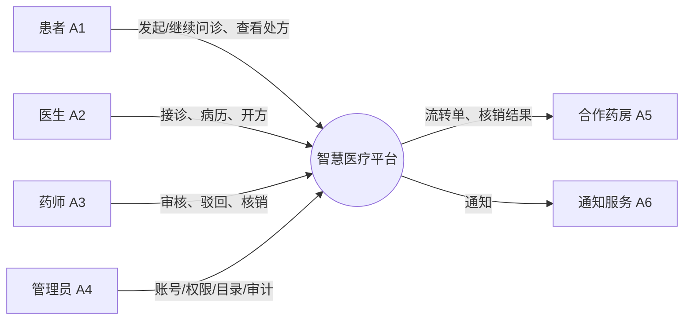

# 用例清单与权限边界（Use Case Inventory）

> 本文档是第 1 轮（R1-C）的需求基线，回答三个问题：**系统对谁提供什么价值、每个用例做到什么程度、谁在什么数据范围内能做什么**。
> 用例来源：《软件工程实验报告》表 2-4～表 2-7（患者 8、医生 7、药师 6、管理员 6，共 27 个）；
> 另按报告表 2-8 的参与者 A5（合作药房系统）与功能 F20–F22 补充 2 个系统间用例，合计 **29 个**。
> 权限边界来自报告表 2-8 权限矩阵与《代码实现方案》§6.2；接口与错误码在 R2 冻结。

| 文档版本 | 更新日期 | 负责人 | 状态 | 关联文档 |
|---|---|---|---|---|
| v1.0 | 2026-11-03 | C | 待评审 | `docs/design/domain-model.md`（D，R1）、`docs/requirements/requirements.md`（B，R1）、`docs/design/api-contract.md`（B，R2）、`docs/test/test-plan.md`（F，R1） |

---

## 1. 目的与范围

### 1.1 本文档回答什么

1. **有哪些用例**——29 个用例的编号、名称、参与者、优先级与一句话目标；
2. **每个用例的边界**——前置条件、主成功场景、主要异常，避免“功能写了但异常没定义”；
3. **谁能做、能对哪些数据做**——角色、权限点、数据范围（本人 / 科室 / 本药房 / 全部）；
4. **越权与重放怎么判**——可直接转成 D 的测试用例与 F 的验收用例。

**不在本文档范围**：页面布局与交互细节（R2 前端）、接口字段与状态码细节（`docs/design/api-contract.md`）、物理表结构（`database/schema.sql`）。本文档只定义“行为与边界”，不定义“实现”。

### 1.2 优先级定义

| 级别 | 含义 | 判定标准 | 处理策略 |
|---|---|---|---|
| **E**（Essential） | 必须实现 | 主业务闭环的一环，或医疗合规硬要求；缺失则无法演示、无法验收 | v1.0 必须完成，验收 100% 覆盖 |
| **H**（High） | 重要 | 影响可用性、可追溯性或运营效率，但可降级为只读/人工 | v1.0 完成；资源不足时可降级，须记录 |
| **M**（Medium） | 一般 | 体验增强，不影响闭环与合规 | 可延后至 v1.1，答辩时说明取舍 |

> 与报告表 2-4～表 2-7 的 E/H/M 保持一致；仅对补充的 UC-F01/F02 按闭环必要性定为 E。

### 1.3 用例编号规则

```text
UC-<角色首字母><两位序号>
P = 患者（Patient）   D = 医生（Doctor）   H = 药师（Pharmacist）
A = 管理员（Admin）   F = 合作药房（Pharmacy，外部系统）
```

编号一经发布不再复用；用例拆分用 `-1/-2` 后缀，废弃用例保留编号并标注“已废弃”。

### 1.4 与功能清单的对应

报告表 2-8 的 F01–F28 是“功能点”，本文档的 UC 是“参与者目标”。一个 UC 可包含多个 F，映射见 §3 的“功能编号”列。**验收以 UC 为准，开发排期以 F 为准**，两者不得各自新增而不回写。

---

## 2. 参与者与系统边界

### 2.1 参与者清单

| 编号 | 参与者 | 类型 | 职责与权限边界 |
|---|---|---|---|
| A1 | 患者 | 人类 | 维护本人档案与授权；发起/继续**本人**问诊；查看**本人**处方与用药指导；不得查看他人任何数据 |
| A2 | 医生 | 人类 | 接诊**本人队列**中的会话；书写病历；为**本人接诊**患者开具处方；不得审核本人处方 |
| A3 | 药师 | 人类 | 审核**本药房**待审处方；通过、驳回；按授权维护药品目录；**不得修改处方内容** |
| A4 | 管理员 | 人类 | 账号、角色、权限策略、药品目录、审计与统计；**不得直接开具或修改处方** |
| A5 | 合作药房系统 | 外部系统 | 接收流转处方、回传接方与核销结果；通过 mTLS 与请求签名接入；只能访问**本药房**流转单 |
| A6 | 通知服务 | 外部系统 | 发送短信/站内通知；只接收最小必要字段（不含诊断与处方明细），不回传业务数据 |

### 2.2 系统边界



边界约定：

1. 平台**不直接对接**医院 HIS、医保与支付；合作药房是唯一的外部业务系统；
2. 药房只能看到为它生成的流转单，看不到处方列表、患者档案全文；
3. 通知服务只做“事件 → 消息”投递，不承载业务判断；
4. 所有外部调用都在**业务事务提交之后**（事务发件箱），不允许把外部系统放进同步事务。

---

## 3. 用例总览（29 个）

| 编号 | 用例名称 | 主要参与者 | 优先级 | 一句话目标 | 功能编号 | 主要接口 |
|---|---|---|---|---|---|---|
| UC-P01 | 注册与实名认证 | 患者 | E | 建立可追溯的实名账号 | F01 | `POST /api/v1/auth/register` |
| UC-P02 | 登录与授权 | 患者 | E | 安全进入系统并签署知情同意 | F02、F04 | `POST /api/v1/auth/login` |
| UC-P03 | 发起图文问诊 | 患者 | E | 选择医生并提交病情资料 | F05 | `POST /api/v1/consultations` |
| UC-P04 | 继续图文问诊 | 患者 | E | 与接诊医生完成图文沟通 | F07、F10 | `POST /api/v1/consultations/{id}/messages` |
| UC-P05 | 查看问诊记录 | 患者 | H | 回看历史会话与病历摘要 | F07 | `GET /api/v1/consultations` |
| UC-P06 | 查看电子处方 | 患者 | E | 查看处方状态、明细与用药指导 | F23、F24 | `GET /api/v1/prescriptions/{id}` |
| UC-P07 | 撤回/更新授权 | 患者 | H | 管理隐私授权并了解影响 | F04 | `POST /api/v1/consents/{id}/withdraw` |
| UC-P08 | 评价与反馈 | 患者 | M | 对本次问诊服务评价 | — | `POST /api/v1/consultations/{id}/rating` |
| UC-D01 | 查看待接诊队列 | 医生 | E | 找到本人应接诊的会话 | F06（医生视角） | `GET /api/v1/consultations/queue` |
| UC-D02 | 接诊或拒诊 | 医生 | E | 承接会话并进入沟通 | F08 | `POST /api/v1/consultations/{id}/accept` |
| UC-D03 | 书写病历与诊断 | 医生 | E | 形成可追溯的诊疗记录 | F09 | `POST /api/v1/consultations/{id}/record` |
| UC-D04 | 创建/编辑处方草稿 | 医生 | E | 结构化开方并即时校验 | F11、F12、F13、F15、F16 | `POST /api/v1/prescriptions/drafts` |
| UC-D05 | 提交处方 | 医生 | E | 锁定草稿并送药师审核 | F14 | `POST /api/v1/prescriptions/{id}/submit` |
| UC-D06 | 处理驳回 | 医生 | E | 按审核意见修改并重提 | F18 | `PUT /api/v1/prescriptions/{id}/draft` |
| UC-D07 | 查看历史问诊 | 医生 | H | 回看本人接诊记录与处方 | F24 | `GET /api/v1/consultations?doctor=me` |
| UC-H01 | 查看待审处方 | 药师 | E | 按药房与风险查看待办 | — | `GET /api/v1/prescriptions/pending-review` |
| UC-H02 | 审核处方 | 药师 | E | 核对合法性、规范性与适宜性 | F17 | `GET /api/v1/prescriptions/{id}` |
| UC-H03 | 审核通过/签名 | 药师 | E | 通过审核并写入签名摘要 | F19 | `POST /api/v1/prescriptions/{id}/approve` |
| UC-H04 | 驳回处方 | 药师 | E | 说明理由并退回医生 | F18 | `POST /api/v1/prescriptions/{id}/reject` |
| UC-H05 | 处方调剂/核销确认 | 药师 | H | 在药房工作台完成发药与核销 | F21、F22 | `POST /api/v1/circulations/{id}/redeem` |
| UC-H06 | 药品目录维护 | 药师 | H | 按授权维护药品与处方限制 | F27 | `POST /api/v1/drugs` |
| UC-A01 | 用户与角色管理 | 管理员 | E | 账号与角色的全生命周期管理 | F25 | `POST /api/v1/admin/users` |
| UC-A02 | 权限策略配置 | 管理员 | E | 配置权限点与数据范围 | F26 | `PUT /api/v1/admin/roles/{id}/permissions` |
| UC-A03 | 药品目录管理 | 管理员 | E | 维护目录版本与停用状态 | F27 | `PUT /api/v1/drugs/{id}` |
| UC-A04 | 审计日志检索 | 管理员 | H | 按人/单号检索敏感操作 | F28 | `GET /api/v1/audits` |
| UC-A05 | 平台运营统计 | 管理员 | M | 统计问诊、处方、驳回与核销 | F28 | `GET /api/v1/admin/stats` |
| UC-A06 | 合作药房管理 | 管理员 | H | 维护药房资质、密钥与状态 | — | `POST /api/v1/admin/pharmacies` |
| UC-F01 | 接方校验与接收 | 合作药房 | E | 校验流转单真伪并接方 | F21 | `POST /api/v1/circulations/{id}/accept` |
| UC-F02 | 身份核验与核销回传 | 合作药房 | E | 核验取药人并发药核销 | F22 | `POST /api/v1/circulations/{id}/redeem` |

### 3.1 数量与优先级分布

| 参与者 | 用例数 | E | H | M |
|---|---|---|---|---|
| 患者 | 8 | 5 | 2 | 1 |
| 医生 | 7 | 6 | 1 | 0 |
| 药师 | 6 | 4 | 2 | 0 |
| 管理员 | 6 | 3 | 2 | 1 |
| 合作药房 | 2 | 2 | 0 | 0 |
| **合计** | **29** | **20** | **7** | **2** |

> 说明：E 级 20 个构成“问诊—病历—处方—审核—流转—核销”主线与认证/权限基线；H 级 7 个在第一轮实现中允许只读或人工兜底；M 级 2 个为体验项。

---

## 4. 分角色用例说明

> 每行只写到“可开发、可测试”的粒度；更细的字段级规则见 R2 接口契约与 D 的领域模型。
> “权限边界”列同时是 D 的越权测试输入（见 §6.2）。

### 4.1 患者（A1）

| 编号 | 用例 | 优先级 | 前置条件 | 主成功场景 | 主要异常 | 权限/数据边界 |
|---|---|---|---|---|---|---|
| UC-P01 | 注册与实名认证 | E | 未注册；持有可用手机号 | 手机号+验证码注册 → 填写姓名/证件号 → 校验通过 → 生成账号与实名状态 → 展示并签署当前版本知情同意 | 验证码错误/过期；手机号已注册；实名校验不通过 | 只能操作本人账号；证件号加密存储、界面默认脱敏；未实名不可发起问诊 |
| UC-P02 | 登录与授权 | E | 已注册且账号启用 | 账号密码或短信登录 → 签发短期访问令牌 + 刷新令牌 → 展示隐私政策与问诊须知 → 同意后写入同意记录 | 密码错误触发限流；账号被禁用；令牌过期需重新登录 | 一次登录只产生本人会话；令牌 15 分钟、刷新令牌轮换；撤回授权保留历史记录 |
| UC-P03 | 发起图文问诊 | E | 已登录、已实名、已同意当前版本 | 选择科室/医生 → 填写主诉并上传资料 → 系统校验 → 创建会话并生成候诊号 → 返回预计等待时间 | 必填缺失提示具体字段；附件类型/大小不符拒绝；医生停诊推荐同科室其他医生 | 只能为本人发起；同一患者对同一医生同一时间仅允许一个进行中会话；主诉 ≤ 1000 字 |
| UC-P04 | 继续图文问诊 | E | 会话处于“待接诊”或“进行中”，本人为参与方 | 查看消息历史 → 发送文字/图片 → 查看医生回复 → 问诊结束 → 查看摘要 | 会话已结束/取消时禁止发送；网络失败保留本地草稿 | 仅会话参与方可读写；消息按客户端消息 ID 去重 |
| UC-P05 | 查看问诊记录 | H | 已登录 | 按时间倒序查看历史会话、病历摘要与处方入口 | 无记录时展示空态 | 仅本人；病历只读，不可编辑 |
| UC-P06 | 查看电子处方 | E | 已登录且存在本人处方 | 查看处方状态、药品明细、用法用量、用药指导与流转进度 | 处方已过期/已取消时展示原因与替代建议 | 仅本人；不展示其他患者与药师内部意见以外的敏感信息 |
| UC-P07 | 撤回/更新授权 | H | 已登录且存在有效授权 | 查看已授权项 → 撤回非必要授权 → 展示撤回影响 | 撤回后发起问诊被拦截；重复撤回幂等 | 仅本人；历史同意记录不回删，只追加撤回时间 |
| UC-P08 | 评价与反馈 | M | 会话已结束 | 评分 + 文字反馈 → 提交 → 展示已提交状态 | 重复评价以最后一次为准；内容违规被拦截 | 仅本人会话；评价不改变处方与病历 |

### 4.2 医生（A2）

| 编号 | 用例 | 优先级 | 前置条件 | 主成功场景 | 主要异常 | 权限/数据边界 |
|---|---|---|---|---|---|---|
| UC-D01 | 查看待接诊队列 | E | 医生已登录且具备接诊权限 | 查看本人（或本科室）待接诊会话，按等待时长排序，展示主诉摘要 | 无权限返回 403；队列为空展示空态 | 默认仅本人队列；按科室查看需 `consult:queue:department` 权限点 |
| UC-D02 | 接诊或拒诊 | E | 会话“待接诊”且属于本人队列 | 查看患者资料 → 接诊 → 会话转“进行中” → 双方可发消息；拒诊需填写原因 | 会话已被他人接诊（乐观锁）→ 提示并刷新；医生被停用 → 拒绝操作 | 只能接诊本人队列；接诊用条件更新防并发；拒诊原因必填并审计 |
| UC-D03 | 书写病历与诊断 | E | 会话“进行中”且由本人接诊 | 记录主诉、诊断、处置建议 → 签名保存 → 生成病历摘要 | 未接诊不可书写；病历签名后不可修改 | 仅本人接诊会话；签名后只读，修改需作废重签 |
| UC-D04 | 创建/编辑处方草稿 | E | 会话“进行中”、本人接诊、医生具备处方权 | 打开处方笺 → 检索并添加药品 → 填写剂量/频次/疗程/数量 → 实时校验 → 保存草稿 | 非目录药品禁止添加；剂量超限阻断；过敏冲突高亮并需确认；特殊管理药品禁止 | 处方必须绑定会话与患者；仅 `DRAFT` 可编辑；仅本人草稿 |
| UC-D05 | 提交处方 | E | 草稿明细完整且校验通过 | 提交 → 锁定内容 → 状态转“待审核” → 生成药师待办与通知 | 明细为空、版本冲突、库存/资质校验失败均阻断 | 仅本人草稿；提交带幂等键与版本号；提交后不可直接改内容 |
| UC-D06 | 处理驳回 | E | 处方处于“审核驳回” | 查看驳回理由 → 修改明细 → 重新提交 → 版本号递增 | 非原开方医生不可修改；会话已结束需重新发起 | 仅原开方医生；保留完整版本链与驳回理由 |
| UC-D07 | 查看历史问诊 | H | 医生已登录 | 查看本人接诊过的会话、病历与处方 | 无记录展示空态 | 仅本人接诊；不得查看他人接诊记录 |

### 4.3 药师（A3）

| 编号 | 用例 | 优先级 | 前置条件 | 主成功场景 | 主要异常 | 权限/数据边界 |
|---|---|---|---|---|---|---|
| UC-H01 | 查看待审处方 | E | 药师已登录且具备审核权限 | 按药房、时间、风险等级查看待审列表，展示患者过敏史摘要与处方风险标记 | 无待审展示空态；跨药房查询返回 403 | 仅本药房；列表不展示患者证件号等无关字段 |
| UC-H02 | 审核处方 | E | 处方“待审核”且归属本药房 | 查看处方、诊断与过敏史 → 核对用法、剂量、禁忌与重复用药 → 形成审核意见 | 药师无审核权限；药房与处方不匹配；处方已被他人审核（版本冲突） | 药师**不得修改处方内容**；只读患者最小必要信息；审核过程写审计 |
| UC-H03 | 审核通过/签名 | E | 审核通过且签名服务可用 | 写入审核人、签名摘要与时间 → 状态转“已通过” → 通知药房与患者 | 签名失败则保持“待审核”并告警；重复提交幂等返回首次结果 | 仅本药房；签名摘要不可为空；通过后内容锁定 |
| UC-H04 | 驳回处方 | E | 处方“待审核”且归属本药房 | 填写驳回理由（≥ 10 字）→ 状态转“审核驳回” → 通知医生 → 保留版本链 | 理由过短或为空阻断；处方已被处理返回冲突 | 仅本药房；驳回理由对医生可见、对患者展示简化说明 |
| UC-H05 | 处方调剂/核销确认 | H | 流转单“已接方” | 核验取药人身份 → 调剂 → 登记批号 → 核销 → 生成发药记录 | 身份不符拒绝；重复核销返回首次结果；处方过期拒绝核销 | 仅本药房；核销幂等；发药记录写入后不可改 |
| UC-H06 | 药品目录维护 | H | 药师具备目录维护授权 | 新增/停用药品，维护剂量上限、疗程上限与处方限制 | 双人复核未通过不可生效；被引用药品停用需提示影响 | 按授权范围；所有变更写审计；不得删除被引用药品 |

### 4.4 管理员（A4）

| 编号 | 用例 | 优先级 | 前置条件 | 主成功场景 | 主要异常 | 权限/数据边界 |
|---|---|---|---|---|---|---|
| UC-A01 | 用户与角色管理 | E | 管理员已登录 | 新增/禁用账号、重置密码、分配角色 → 变更即时生效 | 禁用自己或最后一个超级管理员被禁止；角色不存在 | 可管理全部账号；**不得查看问诊消息、病历正文** |
| UC-A02 | 权限策略配置 | E | 管理员已登录 | 配置角色权限点与数据范围 → 版本化生效 → 影响在线会话 | 变更影响在线会话需二次确认；非法权限点拒绝 | 全部权限点；变更写审计，可回滚到上一版本 |
| UC-A03 | 药品目录管理 | E | 管理员已登录 | 维护药品、规格、分类、处方限制、停用/启用 | 被处方引用的药品只能停用不能删除；重复编码拒绝 | 全部；停用不影响历史处方展示 |
| UC-A04 | 审计日志检索 | H | 管理员已登录 | 按操作人、时间、处方号、动作检索 → 查看详情 → 导出 | 无结果空态；导出超限需分页 | 只读、不可删除；哈希链可校验；导出记录本身也写审计 |
| UC-A05 | 平台运营统计 | M | 管理员已登录 | 查看问诊量、处方量、驳回率、核销率与趋势 | 数据延迟展示“截至时间” | 仅聚合数据，不含个人信息 |
| UC-A06 | 合作药房管理 | H | 管理员已登录 | 维护药房资质、服务范围、接入密钥与状态 | 资质过期自动转“停用”；密钥轮换需双人确认 | 全部；密钥只存引用，不落明文、不回显 |

### 4.5 合作药房系统（A5）

> 这两个用例由外部系统发起，平台侧以接口形式提供；人工操作入口在药房工作台（R2 前端）。

| 编号 | 用例 | 优先级 | 前置条件 | 主成功场景 | 主要异常 | 权限/数据边界 |
|---|---|---|---|---|---|---|
| UC-F01 | 接方校验与接收 | E | 流转单“已创建”；药房资质为“启用” | 接收流转通知 → 校验处方真伪、有效期与服务范围 → 接方 → 状态转“已接方” → 回传接方时间 | 药房拒接需说明原因；签名校验失败拒绝；超时未接方进入人工跟进 | mTLS + 请求签名；只能访问本药房流转单 |
| UC-F02 | 身份核验与核销回传 | E | 流转单“已接方” | 核验取药人身份（取药码/人脸流水）→ 调剂发药 → 回传核销结果 → 状态转“已核销” → 生成发药记录 | 身份不符拒绝发药并登记；重复核销幂等返回首次结果；网络超时按幂等键重试 | 仅本药房；幂等键唯一；发药记录不可改 |

---

## 5. 关键用例规格

> 按报告表 2-12～表 2-16 选取 5 个跨角色、跨状态的关键用例，给出可评审、可测试的完整规格。其余用例以 §4 的表格为准。

### 5.1 UC-P03 发起图文问诊

| 项目 | 内容 |
|---|---|
| 用例名称 | UC-P03 发起图文问诊 |
| 参与者 | 患者（A1） |
| 前置条件 | 患者已登录、完成实名认证并签署当前版本知情同意；所选医生处于可接诊状态 |
| 基本流 | 1. 患者选择科室/医生；2. 填写主诉、病史并上传资料；3. 系统校验必填项与附件类型；4. 创建会话并生成候诊号；5. 返回会话详情与预计等待时间 |
| 异常流 | 3a 必填项缺失：提示具体字段；3b 附件超限/类型不符：拒绝上传；4a 医生停诊：推荐同科室其他医生 |
| 后置条件 | 会话状态为“待接诊”，患者与医生均可在权限范围内查看 |
| 业务规则 | 同一患者同一医生同一时间只允许一个进行中的会话；主诉不超过 1000 字；附件仅允许图片/PDF |

### 5.2 UC-D02 接诊与会话

| 项目 | 内容 |
|---|---|
| 用例名称 | UC-D02 接诊或拒诊 |
| 参与者 | 医生（A2） |
| 前置条件 | 医生已登录且具备接诊权限；会话处于“待接诊”且属于本人队列 |
| 基本流 | 1. 医生查看患者资料；2. 点击接诊；3. 系统校验会话归属与状态；4. 会话变为“进行中”；5. 双方可发送图文消息 |
| 异常流 | 3a 会话已被其他医生接诊：提示并刷新队列；3b 医生被停用：拒绝操作；消息发送失败时保留本地草稿 |
| 后置条件 | 会话进入“进行中”，产生接诊时间与操作审计 |
| 业务规则 | 医生只能接诊本人队列；接诊使用乐观锁防止并发重复接诊；消息内容需做敏感词与违规内容检测 |

### 5.3 UC-D04 创建/编辑处方草稿

| 项目 | 内容 |
|---|---|
| 用例名称 | UC-D04 创建/编辑处方草稿 |
| 参与者 | 医生（A2） |
| 前置条件 | 会话处于“进行中”且由本人接诊；医生具备处方权；患者存在有效档案 |
| 基本流 | 1. 医生打开处方笺；2. 检索并添加药品；3. 填写剂量、频次、疗程、数量；4. 系统实时校验目录、剂量、过敏与重复用药；5. 保存草稿 |
| 异常流 | 4a 药品不在互联网目录：禁止添加；4b 剂量超限：提示并阻断；4c 过敏史冲突：高亮警告并要求确认；保存失败时提示重试 |
| 后置条件 | 生成处方草稿，状态为“待开具”，记录版本号与最后修改人 |
| 业务规则 | 处方必须绑定会话与患者；麻醉/精神类等特殊药品不进入互联网处方目录；草稿可编辑，提交后锁定 |

### 5.4 UC-D05 + UC-H02 提交与审核处方

| 项目 | 内容 |
|---|---|
| 用例名称 | UC-D05 提交处方 / UC-H02 审核处方 |
| 参与者 | 医生（A2）、药师（A3） |
| 前置条件 | 处方状态为“待开具”，明细完整且校验通过；药师具备审核权限并与处方药房匹配 |
| 基本流 | 1. 医生提交处方；2. 系统校验状态、版本、库存与签名权；3. 处方变为“待审核”；4. 药师查看处方与患者过敏史；5. 药师通过并签名或驳回并说明理由 |
| 异常流 | 2a 版本冲突：提示刷新；2b 库存不足：阻断并提示；5a 驳回：处方变为“审核驳回”，回到医生修改；5b 审核超时：进入待办提醒 |
| 后置条件 | 通过则状态为“待流转”，写入审核人与签名摘要；驳回则保留版本链并通知医生 |
| 业务规则 | 药师不得修改处方内容；审核通过后内容不可修改，只能作废重开；审核动作必须记录意见、时间与签名 |

### 5.5 UC-H05 + UC-A04 流转与核销

| 项目 | 内容 |
|---|---|
| 用例名称 | UC-H05 核销确认 / UC-A04 审计追溯 |
| 参与者 | 药师（A3）、合作药房（A5）、管理员（A4） |
| 前置条件 | 处方状态为“待流转”；合作药房资质有效；流转单已生成 |
| 基本流 | 1. 平台生成流转单并发送药房；2. 药房校验处方真伪与有效期；3. 核验取药人身份；4. 调剂发药；5. 回传核销结果；6. 平台更新为“已核销”；7. 管理员可按处方号检索全链路审计 |
| 异常流 | 2a 药房拒接：流转单退回并通知患者改选；3a 身份核验失败：拒绝发药并登记；5a 重复核销：幂等返回首次结果；5b 网络超时：药房重试，平台按幂等键去重 |
| 后置条件 | 处方状态为“已核销”，生成发药记录与审计日志；患者可查看用药指导 |
| 业务规则 | 核销必须校验处方有效期、取药人身份与流转单归属；核销接口以流转单号 + 操作类型 + 版本作为幂等键 |

---

## 6. 权限矩阵与越权边界

### 6.1 角色 × 功能矩阵

> ● = 可写（含状态变更）；○ = 只读；— = 无权限。括号内为**数据范围约束**。

| 功能 | 患者 | 医生 | 药师 | 管理员 | 数据范围约束 |
|---|---|---|---|---|---|
| 查看问诊会话 | ○ 本人 | ○ 本人接诊 | — | ○ 审计只读 | 患者仅本人；医生仅本人接诊 |
| 发送问诊消息 | ● 本人会话 | ● 本人接诊会话 | — | — | 会话参与方校验 |
| 书写病历 | — | ● 本人接诊 | — | — | 病历签名后不可改 |
| 创建/编辑处方 | — | ● 本人接诊 | — | — | 绑定会话与患者 |
| 提交处方 | — | ● 本人草稿 | — | — | 状态与版本校验 |
| 审核处方 | — | — | ● 本药房 | — | 药师不得审核本人开具处方 |
| 流转处方 | — | — | ● 本药房 | — | 药房资质与状态校验 |
| 核销处方 | — | — | ● 本药房 | — | 身份核验 + 幂等 |
| 查看处方 | ○ 本人 | ○ 本人开具 | ○ 本药房 | ○ 审计只读 | 按角色过滤字段 |
| 药品目录维护 | — | — | ● 按授权 | ● | 双人复核（可选） |
| 用户与角色 | — | — | — | ● | 超级管理员二次确认 |
| 审计日志 | — | — | ○ 本人操作 | ● | 只读、不可删除 |

### 6.2 数据范围与权限点

| 数据范围 | 适用范围 | SQL 追加条件（示意） | 越权结果 |
|---|---|---|---|
| `SELF` | 患者、医生 | `patient_id = :uid` / `doctor_id = :uid` | 403 `SCOPE_DENIED` |
| `DEPARTMENT` | 医生查看本科室队列 | `department_id = :deptId` | 403 `SCOPE_DENIED` |
| `PHARMACY` | 药师、合作药房 | `pharmacy_id = :pharmacyId` | 403 `RX_SCOPE_DENIED` |
| `ALL` | 管理员 | 无追加条件（仅聚合/审计只读） | — |

权限点（与 `docs/design/api-contract.md`、`platform-security` 对齐）：

| 权限点 | 说明 | 默认角色 | 数据范围 | 服务层二次校验 |
|---|---|---|---|---|
| `consult:create` | 发起问诊 | 患者 | SELF | 实名 + 知情同意 + 会话唯一性 |
| `consult:accept` | 接诊/拒诊 | 医生 | SELF | 队列归属 + 乐观锁 |
| `consult:message` | 发送消息 | 患者/医生 | SELF | 参与方 + 会话状态 |
| `record:write` | 书写病历 | 医生 | SELF | 本人接诊 + 未签名 |
| `rx:draft:write` | 创建/编辑草稿 | 医生 | SELF | 本人草稿 + `DRAFT` 状态 |
| `rx:submit` | 提交处方 | 医生 | SELF | 明细非空 + 校验通过 + 版本 |
| `rx:review` | 审核/驳回 | 药师 | PHARMACY | 药房匹配 + `PENDING_REVIEW` |
| `rx:circulate` | 流转处方 | 药师/药房 | PHARMACY | 资质有效 + 幂等键 |
| `rx:redeem` | 核销 | 药师/药房 | PHARMACY | 身份凭证 + 未过期 + 幂等 |
| `drug:manage` | 药品目录维护 | 管理员/药师 | ALL/授权 | 双人复核 + 停用不删除 |
| `user:manage` | 账号与角色 | 管理员 | ALL | 不得禁用最后一个超管 |
| `perm:manage` | 权限策略 | 管理员 | ALL | 变更审计 + 版本回滚 |
| `audit:read` | 审计检索 | 管理员 | ALL | 只读 + 导出留痕 |

> **原则**：Controller 只做权限点粗筛，**数据归属必须在应用服务层再校验一次**（`belongsTo` / `canAccess`），防止改 ID 越权（IDOR）；前端隐藏按钮不作为安全边界。

### 6.3 必须覆盖的越权与边界场景

| # | 场景 | 期望结果 | 错误码 / HTTP | 对应用例 | 计划测试编号 |
|---|---|---|---|---|---|
| 1 | 患者 A 访问患者 B 的会话 | 拒绝且不返回内容 | `SCOPE_DENIED` / 403 | UC-P04、UC-P05 | ST-03 |
| 2 | 医生接诊非本人队列的会话 | 拒绝 | `SESSION_CONFLICT` / 409 | UC-D02 | ST-03 |
| 3 | 药师审核非本药房处方 | 拒绝 | `RX_SCOPE_DENIED` / 403 | UC-H02 | ST-03 |
| 4 | 药师尝试修改处方明细 | 接口不存在 / 拒绝 | 403（无 `rx:draft:write`） | UC-H02 | ST-04 |
| 5 | 管理员尝试开方或改方 | 拒绝 | 403（无 `rx:*` 写权限点） | UC-A01 | ST-04 |
| 6 | 药房核销非本药房流转单 | 拒绝 | `SCOPE_DENIED` / 403 | UC-F02 | ST-05 |
| 7 | 重复核销（同一幂等键） | 返回首次结果 | 200（幂等） | UC-F02、UC-H05 | ST-05 |
| 8 | 重复核销（不同幂等键） | 拒绝 | `RX_ALREADY_REDEEMED` / 409 | UC-F02 | ST-05 |
| 9 | 过期处方核销 | 拒绝 | `RX_EXPIRED` / 409 | UC-H05 | ST-05 |
| 10 | 未接方直接核销 | 拒绝 | `CIRC_STATE_INVALID` / 409 | UC-F02 | SM-06 |

---

## 7. 与状态机、接口、数据、测试的追踪

### 7.1 用例 → 状态 → 接口 → 表

| 用例组 | 关键状态 | 主要接口 | 主要数据表 | 计划测试 |
|---|---|---|---|---|
| UC-P01、UC-P02、UC-P07 | `ENABLED/DISABLED`、同意记录 | `/auth/register`、`/auth/login`、`/consents/*` | `sys_user`、`sys_role`、`consent_record` | FT-01、ST-01、ST-02 |
| UC-P03、UC-P04、UC-D01、UC-D02 | `WAITING → IN_PROGRESS → ENDED/CANCELLED` | `/consultations`、`/{id}/accept`、`/{id}/messages` | `consultation_session`、`consultation_message` | FT-02、FT-03、ST-03 |
| UC-D03 | 病历签署 | `/consultations/{id}/record` | `medical_record` | FT-04 |
| UC-D04、UC-D05、UC-D06 | `DRAFT → PENDING_REVIEW → REJECTED → DRAFT` | `/prescriptions/drafts`、`/{id}/submit`、`/{id}/draft` | `prescription`、`prescription_item` | SM-01～SM-08、FT-11～FT-15 |
| UC-H01～UC-H04 | `PENDING_REVIEW → APPROVED/REJECTED` | `/{id}/approve`、`/{id}/reject` | `prescription`、`audit_log` | SM-03～SM-05、FT-17～FT-19 |
| UC-H05、UC-F01、UC-F02 | `APPROVED → CIRCULATED → REDEEMED` | `/circulations/{id}/accept`、`/{id}/redeem` | `circulation_order`、`dispense_record` | SM-06～SM-08、FT-20～FT-22、ST-05 |
| UC-A01～UC-A06 | 账号/权限/目录版本 | `/admin/*`、`/drugs/*`、`/audits` | `sys_user_role`、`drug`、`audit_log` | FT-25～FT-28、ST-06 |
| UC-P06、UC-P08 | 处方只读与评价 | `/prescriptions/{id}`、`/{id}/rating` | `prescription`、`notification` | FT-16、FT-23 |

### 7.2 与领域模型的对应

- 处方相关用例（UC-D04～D06、UC-H02～H04、UC-F01/F02）只能通过 `Prescription` 聚合方法迁移状态，禁止 Controller 直接改 `status`（见 `docs/design/domain-model.md` §5.2、§8.1）；
- 核销相关用例的幂等规则见 `CirculationOrder` 的不变量 I-12～I-15；
- 每个 E 级写用例成功/失败都必须落 `audit_log`（UC-A04 是其查询入口）。

### 7.3 非功能约束如何落到用例

| 约束 | 落到的用例 | 验证方式 |
|---|---|---|
| 审计可追溯 | 所有写用例（UC-P03、UC-D02～D06、UC-H02～H05、UC-A01～A04、UC-F01/F02） | 检查 `audit_log` 是否有操作人、资源、结果、时间 |
| 幂等 | UC-D05、UC-H03、UC-F01/F02 | 相同幂等键重复提交返回首次结果 |
| 乐观锁 | UC-D02、UC-D05、UC-H02 | 并发操作时后到者收到 409 版本冲突 |
| 最小必要 | UC-P06、UC-H02、UC-F01 | 返回字段清单核对，不含证件号、住址等无关字段 |
| 时效 | UC-P06、UC-H05、UC-F02 | 超过 72 小时的处方变为 `EXPIRED`，核销被拒 |
| 限流 | UC-P02、UC-P01 | 连续失败登录触发锁定/验证码 |

---

## 8. 待确认问题（评审输入）

| # | 问题 | 当前倾向 | 影响 |
|---|---|---|---|
| 1 | 29 个用例中 2 个药房用例是否纳入“系统边界内”？ | 纳入，按外部系统参与者建模（A5） | 影响用例图与接口鉴权方式（mTLS） |
| 2 | 一次问诊会话是否允许多张处方？ | 允许（1:0..*），但同一会话同时只有一个 `DRAFT` | 影响 `uk_session_draft` 与 UC-D04 |
| 3 | 处方流转由谁发起：患者选药房，还是药师/系统派单？ | v1 由患者选择合作药房，药师确认后生成流转单 | 影响 UC-P06、UC-H05、UC-F01 的参与者 |
| 4 | 驳回理由最小长度 10 字是否合适？ | 保留 10 字，前端给出提示 | 影响 UC-H04 校验与测试用例 |
| 5 | 处方有效期 72 小时是否可配置？ | 可配置，按科室/药品分类覆盖 | 影响 UC-H05、UC-F02 的过期判定 |
| 6 | 管理员能否代开处方？ | 不能；权限点层面不授予 `rx:*` 写权限 | 影响 UC-A01、越权用例 ST-04 |
| 7 | 评价与反馈（UC-P08）是否进入 v1.0？ | 暂定 M 级，v1.0 可只保留评分 | 影响验收范围与页面工作量 |
| 8 | 患者撤回授权后，历史处方是否仍可见？ | 可见但仅本人 + 审计，做脱敏展示 | 影响 UC-P07、UC-P06 与字段脱敏 |

> 以上问题在 R1 评审会确认，结论写入 `docs/process/review-01.md`（F），并同步更新本文档与 `docs/design/domain-model.md`。

---

## 9. 变更记录

| 版本 | 日期 | 变更 | 作者 |
|---|---|---|---|
| v1.0 | 2026-11-03 | 初稿：29 个用例（患者 8、医生 7、药师 6、管理员 6、合作药房 2）、关键用例规格、权限矩阵、越权边界与追踪表 | C |
