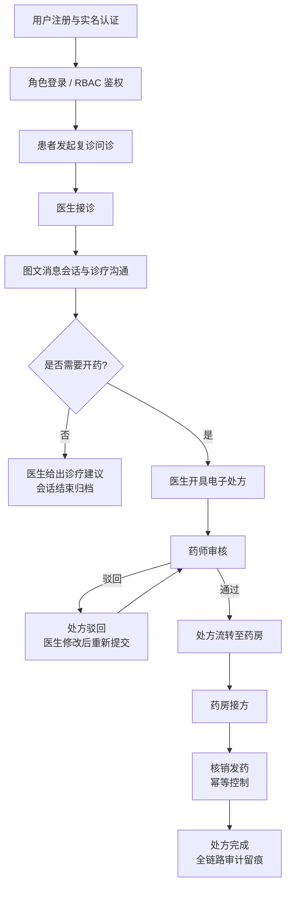

# 需求规格说明书（Software Requirements Specification）

## 文档信息

| 项目 | 内容 |
|---|---|
| 项目名称 | 互联网医院在线问诊与处方流转平台（简称：问诊处方平台） |
| 文档名称 | 需求规格说明书（requirements.md） |
| 文档版本 | v1.0（第 1 轮需求基线） |
| 文档状态 | 基线草案（Baseline Draft） |
| 作者 | 李梓语（角色：问诊域、处方域负责人） |
| 创建日期 | 2026-11-06 |
| 适用轮次 | 第 1 轮：仓库治理与需求基线 |
| 关联文档 | `docs/requirements/use-cases.md`（用例清单）、`docs/design/domain-model.md`（领域模型）、`database/schema.sql`（数据库草案） |

### 修订记录

| 版本 | 日期 | 修订人 | 修订内容 |
|---|---|---|---|
| v1.0 | 2026-11-06 | 李梓语 | 建立需求基线，明确项目范围、参与者、约束与非功能需求 |

---

## 1 引言

### 1.1 编写目的

本文档是问诊处方平台的需求基线，用于统一项目组对"系统做什么、不做什么、受什么约束、达到什么质量标准"的理解，为后续的用例分析（`use-cases.md`）、领域建模、数据库设计、接口契约设计与测试验收提供唯一可追溯的需求依据。

本文档的预期读者包括：

1. 项目组全体开发成员，用于指导设计与实现；
2. 测试人员，用于推导验收标准与测试策略；
3. 课程评审与答辩教师，用于检查需求完整性与工程规范性；
4. 后续迭代维护者，用于判断变更是否偏离基线。

### 1.2 项目背景

随着互联网诊疗监管体系的完善，医疗机构线上化业务需要同时满足**诊疗合规、处方可追溯、用药安全、患者隐私保护**四类要求。传统线下流程中存在处方纸质流转易丢失、药师审核记录难留存、患者无法追踪处方状态等问题。本项目拟构建一个面向"在线复诊—图文问诊—电子处方—药师审核—药房核销发药"全链路的互联网医院平台，采用领域驱动设计（DDD）思想划分业务域，以模块化单体架构落地，支撑患者、医生、药师、药房及平台管理员五类终端用户的协同业务。

### 1.3 文档范围

本文档覆盖：系统业务范围与边界、参与者及其权限边界、功能性需求概述与优先级、合规与技术约束、非功能性需求指标、数据需求、假设与依赖。

本文档**不包含**：具体用例的主备事件流（见 `use-cases.md`）、聚合与实体的领域模型设计（见 `domain-model.md`）、接口字段级契约（第 2 轮 `api-contract.md`）、数据库表结构细节（见 `schema.sql`）。

### 1.4 术语与缩略语

| 术语 | 说明 |
|---|---|
| SRS | Software Requirements Specification，软件需求规格说明书 |
| DDD | Domain-Driven Design，领域驱动设计 |
| RBAC | Role-Based Access Control，基于角色的访问控制 |
| JWT | JSON Web Token，无状态令牌 |
| 复诊 | 患者已在实体医疗机构就诊过同一疾病后的在线复诊；互联网诊疗不得对首诊患者开展 |
| 接诊 | 医生确认接管某一问诊会话，接诊后双方可在会话内收发消息 |
| 处方（Rx） | 医师在诊疗活动中为患者开具的、作为药学文件的医疗文书 |
| 处方审核 | 药师对医师开具处方的合法性、规范性、适宜性进行审核 |
| 核销 | 药房发药时对处方进行一次性确认兑付，防止重复发药 |
| 幂等 | 同一请求执行一次与多次的效果相同，用于防止重复提交与重放 |
| 聚合根 | DDD 中保证一致性边界的核心实体，外部对象仅能通过聚合根引用其内部对象 |
| MoSCoW | 需求优先级方法：Must / Should / Could / Won't |
| NFR | Non-Functional Requirement，非功能需求 |
| RPO/RTO | 恢复点目标 / 恢复时间目标 |

### 1.5 参考资料

1. GB/T 8567-2006《计算机软件文档编制规范》
2. 《互联网诊疗管理办法（试行）》
3. 《处方管理办法》
4. 《电子病历应用管理规范（试行）》
5. 《中华人民共和国个人信息保护法》《中华人民共和国数据安全法》《中华人民共和国网络安全法》
6. 《中华人民共和国电子签名法》
7. GB/T 22239-2019《信息安全技术 网络安全等级保护基本要求》（等保 2.0）

---

## 2 项目范围

### 2.1 系统定位与愿景

本平台定位为**互联网医院的核心业务中台**，打通"诊—方—药"三个环节，实现诊疗行为留痕、处方全生命周期可追溯、用药安全可审计。系统采用四端协同：患者端、医生端、药师端、管理端（药房运营与平台管理复用管理端入口）。

### 2.2 业务范围（In Scope）

| 编号 | 范围域 | 范围说明 |
|---|---|---|
| S-01 | 身份与访问 | 多角色注册、实名认证、登录认证、基于 RBAC 的权限控制与会话管理 |
| S-02 | 图文问诊 | 患者发起复诊问诊、医生接诊、图文消息收发、会话状态管理与问诊记录留存 |
| S-03 | 电子处方 | 医生基于问诊结论开具处方、处方明细管理、处方状态机驱动的全生命周期管理 |
| S-04 | 处方审核 | 药师对处方进行合法性/规范性/适宜性审核，支持通过、驳回并留存审核签名与意见 |
| S-05 | 流转与核销 | 审核通过处方流转至药房、药房接方、核销发药、幂等控制、患者处方状态追踪 |
| S-06 | 管理支撑 | 用户资质管理、基础数据维护、审计日志查询、业务监管与统计 |

### 2.3 范围外（Out of Scope，本期不实现）

1. **首诊业务**：依据合规要求，本平台仅支持常见病、慢性病复诊，不支持首诊问诊；
2. 视频问诊、语音问诊、AI 辅助诊断与智能导诊；
3. 麻醉药品、精神药品等特殊管理药品的线上处方；
4. 在线支付、医保结算、药品物流配送与冷链追踪；
5. 与外部医院 HIS、EMR 系统的真实生产对接（仅预留接口边界，不做联调）；
6. 移动端原生 App，仅提供响应式 Web 端。

### 2.4 业务主流程总览

---

## 3 参与者（Actor）分析

### 3.1 参与者总览

| 参与者 | 定义 | 核心目标 | 权限边界 |
|---|---|---|---|
| 患者 | 接受在线复诊服务的自然人，须完成实名认证 | 发起问诊、与医生沟通、获取处方并追踪发药状态 | 仅能访问本人的问诊会话、处方与消息；不可访问他人数据；不可自行修改处方 |
| 医生 | 具备执业资质并通过平台审核的医师 | 接诊、图文沟通、开具处方、处理被驳回处方 | 仅能操作自己接诊的会话与自己开具的处方；无权审核处方；资质失效后停止接诊权限 |
| 药师 | 具备药学专业资质的处方审核人员 | 审核处方、出具审核意见、电子签名 | 仅能审核待审核处方，无权开具或修改处方；审核行为不可删除，仅可追溯 |
| 药房运营人员 | 药房侧负责接方与发药的运营角色 | 接收流转处方、执行核销发药、登记发药记录 | 仅能操作已流转至本药房的处方；核销不可撤销；无处方内容修改权 |
| 平台管理员 | 平台运营与合规监管人员 | 资质审核、基础数据维护、审计日志与监管统计 | 不参与具体诊疗与处方业务；管理操作全部审计；不可查看消息明文隐私字段（脱敏展示） |

### 3.2 参与者—业务域关系

| 业务域 | 患者 | 医生 | 药师 | 药房运营 | 平台管理员 |
|---|---|---|---|---|---|
| 身份与访问 | ● | ● | ● | ● | ○（管理） |
| 图文问诊 | ● | ● | － | － | ○（监管） |
| 电子处方 | ○（只读本人） | ● | － | － | ○（监管） |
| 处方审核 | － | ○（查看意见） | ● | － | ○（监管） |
| 流转与核销 | ○（追踪） | － | － | ● | ○（监管） |
| 管理支撑 | － | － | － | － | ● |

> 图例：● 主要操作；○ 只读/受限操作；－ 无权限。

### 3.3 关键业务规则

1. **身份唯一**：一个实名身份只能对应一个患者账号；医生、药师账号须绑定执业资质并经管理员审核通过后方可生效；
2. **权责分离**：开方人与审核人不得为同一人，处方审核遵循"双人制衡"原则；
3. **最小权限**：所有角色按 RBAC 仅授予完成职责所必需的最小权限集合，越权访问一律拒绝并记录安全日志；
4. **会话归属**：问诊会话同一时刻仅允许一名医生接诊，医生不可同时接诊超过系统设定上限的会话数。

---

## 4 功能性需求

### 4.1 功能结构

系统功能按 DDD 业务域划分为 6 个一级模块、共 29 个用例（用例明细、主备事件流与优先级见 `docs/requirements/use-cases.md`）。本节给出功能需求概要与业务规则，编号与用例文档保持追溯关系。

### 4.2 身份与访问域（FR-AUTH）

| 编号 | 功能需求 | 业务规则要点 |
|---|---|---|
| FR-AUTH-01 | 用户注册与实名认证 | 采集实名信息并校验身份；患者实名、医生/药师额外上传执业资质 |
| FR-AUTH-02 | 登录与令牌签发 | 校验凭据后签发 JWT；密码采用加盐哈希存储，禁止明文落库 |
| FR-AUTH-03 | 角色权限控制 | 基于 RBAC 在接口层进行角色与资源归属双重校验 |
| FR-AUTH-04 | 资质审核与账号状态管理 | 管理员审核执业资质；账号存在正常、停用、注销等状态 |
| FR-AUTH-05 | 登出与令牌失效 | 支持主动登出，令牌具备有效期与失效机制 |

### 4.3 图文问诊域（FR-CONS）

| 编号 | 功能需求 | 业务规则要点 |
|---|---|---|
| FR-CONS-01 | 发起问诊 | 患者选择复诊疾病与科室创建会话；系统校验实名状态与复诊资格 |
| FR-CONS-02 | 医生接诊 | 医生从待接诊列表接诊；接诊后会话归属该医生，状态由"待接诊"转为"进行中" |
| FR-CONS-03 | 图文消息收发 | 支持文本、图片类消息；消息按会话时序存储，支持已读状态 |
| FR-CONS-04 | 会话状态管理 | 会话包含待接诊、进行中、已结束、已归档等状态，状态迁移须合法 |
| FR-CONS-05 | 会话结束与归档 | 医生或患者结束会话后归档；归档会话只读，作为诊疗记录留存 |
| FR-CONS-06 | 问诊记录查询 | 患者可查本人记录，医生可查本人接诊记录，全程留痕不可物理删除 |

### 4.4 电子处方域（FR-RX）

| 编号 | 功能需求 | 业务规则要点 |
|---|---|---|
| FR-RX-01 | 处方开具 | 医生仅能对自己进行中的问诊会话开方；处方包含患者信息、诊断、药品明细、用法用量 |
| FR-RX-02 | 处方明细管理 | 支持多条药品明细；记录数量、剂量、频次、疗程；自动汇总金额 |
| FR-RX-03 | 处方状态机 | 处方全生命周期由 8 个状态驱动（见 4.4.1），仅允许合法迁移，非法迁移须被拒绝 |
| FR-RX-04 | 处方修改与重新提交 | 审核驳回的处方允许医生修改后重新提交，保留全部历史版本 |
| FR-RX-05 | 处方查询与追踪 | 患者只读本人处方；医生、药师按职责范围查询 |
| FR-RX-06 | 处方时效控制 | 处方自开具起设定有效期，超期未审核或未兑付自动置为失效 |

#### 4.4.1 处方状态机（8 状态）

| 状态 | 英文标识 | 含义 | 典型下一状态 |
|---|---|---|---|
| 草稿 | DRAFT | 医生编辑中、尚未提交 | 待审核 / 已撤销 |
| 待审核 | PENDING_REVIEW | 已提交，等待药师审核 | 审核通过 / 审核驳回 |
| 审核通过 | APPROVED | 药师审核通过，可流转 | 调配中 / 已失效 |
| 审核驳回 | REJECTED | 药师驳回并附审核意见 | 草稿（修改后重提）/ 已撤销 |
| 已撤销 | CANCELLED | 医生主动撤销，终态 | － |
| 已失效 | EXPIRED | 超期未处理或未兑付，终态 | － |
| 调配中 | DISPENSING | 药房接方，进入发药环节 | 已完成 |
| 已完成 | COMPLETED | 核销发药完成，终态 | － |

> 状态机的正向与非法迁移测试在第 4 轮由测试负责人以 `PrescriptionStateTest.java` 覆盖。

### 4.5 处方审核域（FR-REV）

| 编号 | 功能需求 | 业务规则要点 |
|---|---|---|
| FR-REV-01 | 待审核处方队列 | 药师按提交时间查看待审核处方，支持按科室筛选 |
| FR-REV-02 | 处方审核通过 | 校验合法性、规范性、适宜性后通过，留存审核意见与电子签名 |
| FR-REV-03 | 处方驳回 | 填写结构化驳回原因后驳回；驳回意见对医生可见且不可删除 |
| FR-REV-04 | 审核记录追溯 | 审核人、时间、意见、签名完整留痕，支持审计查询 |

### 4.6 流转与核销域（FR-CIRC）

| 编号 | 功能需求 | 业务规则要点 |
|---|---|---|
| FR-CIRC-01 | 处方流转 | 审核通过的处方生成流转单，按药房路由推送 |
| FR-CIRC-02 | 药房接方 | 药房确认接收后处方进入调配中 |
| FR-CIRC-03 | 核销发药 | 凭处方执行核销；以幂等键保证重复请求只兑付一次 |
| FR-CIRC-04 | 发药记录 | 登记发药人、发药时间等信息，与处方关联归档 |
| FR-CIRC-05 | 患者处方追踪 | 患者实时查看处方当前状态与流转节点 |

### 4.7 管理支撑域（FR-ADM）

| 编号 | 功能需求 | 业务规则要点 |
|---|---|---|
| FR-ADM-01 | 基础数据维护 | 科室、药品字典等基础数据的增删改查 |
| FR-ADM-02 | 审计日志查询 | 关键业务操作与安全事件集中审计，日志只增不改 |
| FR-ADM-03 | 业务监管统计 | 问诊量、处方量、审核通过率等统计，支撑合规监管 |

### 4.8 需求优先级（MoSCoW）

| 优先级 | 需求 | 说明 |
|---|---|---|
| Must（必须实现） | FR-AUTH 全部、FR-CONS-01~05、FR-RX-01~04、FR-REV-01~03、FR-CIRC-01~04 | 构成"诊—方—药"主链路，缺失则系统核心价值不成立 |
| Should（应该实现） | FR-CONS-06、FR-RX-05~06、FR-ADM-01~02、FR-CIRC-05 | 支撑合规留痕与用户体验，可在迭代内紧前安排 |
| Could（可以实现） | FR-ADM-03 高级统计、消息已读等增强项 | 资源允许时实现，不影响主流程验收 |
| Won't（本期不做） | 视频问诊、支付医保、物流配送、原生 App | 见 2.3 范围外，后续版本评估 |

---

## 5 约束条件

### 5.1 合规与法规约束

| 编号 | 约束 | 来源与要求 |
|---|---|---|
| C-LEGAL-01 | 禁止首诊 | 互联网诊疗仅适用于常见病、慢性病复诊，发起问诊时须校验复诊资格 |
| C-LEGAL-02 | 处方实名制与资质要求 | 处方须绑定实名患者与具备资质的医师；药师须具备审核资质 |
| C-LEGAL-03 | 特殊药品禁售 | 麻醉药品、精神药品等特殊管理药品不得通过本平台开具 |
| C-LEGAL-04 | 电子签名 | 处方开具与审核须使用符合《电子签名法》要求的可靠电子签名 |
| C-LEGAL-05 | 病历留存期限 | 问诊记录、处方及审核记录须在线留存，门诊病历保存期限不少于 15 年 |
| C-LEGAL-06 | 个人信息保护 | 处理个人信息遵循合法、正当、必要与最小化原则，敏感医疗信息须单独告知并取得同意 |
| C-LEGAL-07 | 等级保护 | 安全设计参照等保 2.0 三级要求，覆盖身份鉴别、访问控制、安全审计与数据保密性 |
| C-LEGAL-08 | 数据出境与共享 | 未经授权不得向第三方提供患者数据；对外共享须脱敏并具备授权记录 |

### 5.2 技术约束

| 编号 | 约束 | 说明 |
|---|---|---|
| C-TECH-01 | 后端技术栈 | Java + Spring Boot，采用 DDD 分层与模块化单体架构 |
| C-TECH-02 | 数据存储 | 关系型数据库 MySQL，通过迁移脚本（migration）管理表结构版本 |
| C-TECH-03 | 接口风格 | RESTful API，JSON 报文，接口契约以 OpenAPI 描述 |
| C-TECH-04 | 认证机制 | 无状态 JWT + RBAC，接口级鉴权 |
| C-TECH-05 | 前端形态 | 响应式 Web 四端，按角色路由隔离页面 |
| C-TECH-06 | 部署方式 | Docker 本地编排，CI 自动构建，配置与代码分离 |
| C-TECH-07 | 禁止提交敏感配置 | `.env`、密钥、真实患者数据、`target/`、`node_modules/` 等不得进入版本库 |

### 5.3 项目与过程约束

1. 团队共 6 名成员、6 轮迭代，角色 A–F 职责固定，每人使用本人 GitHub 账号提交，每轮至少 1 个 commit、建议 1 个 PR；
2. 分支命名遵循 `feat/<模块>-<短描述>`、`fix/<问题>`、`docs/<主题>`；提交信息遵循 `<type>(<scope>): <what> [R<n>][<member>]`；
3. 每个 PR 须说明：改了什么、如何验证、影响哪些表/接口/测试、是否使用 AI 辅助；
4. 需求基线一经确认，后续变更须通过 PR 评审并更新本文档修订记录，禁止口头改需求。

---

## 6 非功能性需求（NFR）

### 6.1 量化指标总表

| 编号 | 类别 | 指标要求 | 度量/验证方式 |
|---|---|---|---|
| NFR-PERF-01 | 性能 | 常规业务接口在标准负载下 P95 响应时间 ≤ 500 ms | 压测工具统计响应时间分布 |
| NFR-PERF-02 | 性能 | 消息从发送到对端可见延迟 ≤ 1 s | 端到端埋点计时 |
| NFR-PERF-03 | 性能 | 支持 ≥ 1000 并发用户在线、核心接口错误率 ≤ 0.1% | 阶梯压力测试 |
| NFR-AVAIL-01 | 可用性 | 系统可用性 ≥ 99.9%（月度） | 运行时间监控统计 |
| NFR-AVAIL-02 | 可靠性 | 核心业务数据 RPO ≤ 15 分钟，RTO ≤ 30 分钟 | 备份恢复演练 |
| NFR-SEC-01 | 传输安全 | 全链路 HTTPS，TLS ≥ 1.2，禁用弱加密套件 | 安全扫描与配置核查 |
| NFR-SEC-02 | 存储安全 | 密码加盐哈希存储；敏感字段（身份证号、手机号等）加密或脱敏存储 | 代码审查与数据抽样核查 |
| NFR-SEC-03 | 访问控制 | 所有业务接口默认鉴权，越权访问拒绝率 100% 并记录安全日志 | 越权测试用例 |
| NFR-SEC-04 | 审计 | 登录、开方、审核、核销等关键操作 100% 审计，日志防篡改、保留 ≥ 15 年 | 审计完整性核查 |
| NFR-SEC-05 | 防重放 | 核销等关键写操作具备幂等机制，重复提交不产生重复业务效果 | 重放/并发测试 |
| NFR-PRIV-01 | 隐私 | 个人信息按最小必要采集，列表展示默认脱敏，导出须授权留痕 | 隐私检查表逐项核对 |
| NFR-COMP-01 | 兼容性 | 支持 Chrome、Edge 最近两个大版本，主流分辨率（1366×768 及以上）正常使用 | 多浏览器回归测试 |
| NFR-MAINT-01 | 可维护性 | 按 DDD 分层与业务域模块化，核心模块公共方法具备单元测试 | 代码结构评审与覆盖率统计 |
| NFR-OBS-01 | 可观测性 | 具备日志、关键指标与健康检查端点，异常可告警 | 运维监控平台验证 |
| NFR-DATA-01 | 数据一致性 | 处方状态迁移与库存/发药记录保持强一致，不允许出现"已完成但无发药记录" | 一致性校验脚本与测试 |
| NFR-EXT-01 | 可扩展性 | 业务域之间通过明确定义的接口交互，新增业务域不修改既有核心表结构 | 架构评审与变更影响分析 |

### 6.2 安全设计原则

1. **默认拒绝**：除显式声明的公开接口（登录、注册）外，所有接口默认需要认证与授权；
2. **纵深防御**：在网关、接口、服务、数据四层分别实施校验，单层失陷不导致整体失守；
3. **失败安全**：鉴权、审核、核销等环节异常时默认拒绝并告警，不允许异常情况下放行；
4. **全程留痕**：任何影响处方状态与患者数据的操作均可追溯到具体自然人与时间。

### 6.3 可用性与容量假设

1. 单校区/单医院演示场景，预期注册用户量级为万级、日活千级；
2. 问诊消息与处方记录为主要数据增长源，数据库设计须为消息表、处方表预留索引与分区演进空间；
3. 系统须支持优雅停机，停机期间在途请求返回明确错误而非数据损坏。

---

## 7 数据需求

| 编号 | 数据需求 | 说明 |
|---|---|---|
| DR-01 | 数据分类分级 | 数据分为公开数据、业务数据、个人信息、敏感个人信息（医疗健康）四级，按级别实施保护 |
| DR-02 | 主数据一致性 | 药品字典、科室、用户等主数据全系统唯一来源，禁止各模块冗余定义 |
| DR-03 | 逻辑删除 | 患者、处方等核心业务数据禁止物理删除，采用状态标记与逻辑删除 |
| DR-04 | 备份恢复 | 数据库支持定期全量备份与增量备份，并定期执行恢复演练验证可用性 |
| DR-05 | 数据量基线 | 数据库初版约 24 张表（见 `schema.sql`），覆盖身份、问诊、处方、审核、流转、审计六类数据 |
| DR-06 | 演示数据 | 测试与答辩使用虚构数据，严禁导入真实患者信息 |

---

## 8 假设与依赖

### 8.1 假设

1. 患者、医生、药师均能通过平台完成实名认证或资质审核，认证服务在演示环境以模拟校验实现；
2. 课程演示环境为本机或局域网，网络稳定，不考虑真实生产环境的分布式多机房部署；
3. 电子签名在课程范围内以密码学签名机制模拟实现，不接入真实 CA 机构。

### 8.2 依赖

1. 依赖 `use-cases.md` 按时完成 29 个用例的事件流细化，以保证功能需求可验收；
2. 依赖领域模型与数据库草案与本需求基线保持一致，出现冲突时以本文档为准并发起评审；
3. 依赖第 2 轮接口契约与 CI 环境就绪，后续功能实现方可并行推进。

---

## 9 需求追溯与验收

### 9.1 追溯矩阵（概要）

| 需求条目 | 对应用例文档 | 对应领域模型 | 对应测试产物 |
|---|---|---|---|
| FR-AUTH | use-cases.md 认证模块 | identity 聚合 | AuthTest（第 3 轮） |
| FR-CONS | use-cases.md 问诊模块 | consultation 会话/消息聚合 | ConsultationTest（第 3 轮） |
| FR-RX / FR-REV | use-cases.md 处方/审核模块 | prescription 聚合 | PrescriptionStateTest（第 4 轮） |
| FR-CIRC | use-cases.md 流转模块 | circulation 聚合 | CirculationIdempotencyTest（第 5 轮） |
| NFR-SEC | － | 安全设计 | 越权/重放/限流测试（第 6 轮） |

### 9.2 验收标准

1. 文档中每个 Must 级功能需求均能在 `use-cases.md` 中找到对应用例，并在后续轮次有实现与测试记录；
2. 每条 NFR 指标可通过测试、监控或检查表验证，不可验证的指标视为无效需求；
3. 全部合规约束（C-LEGAL）在设计与测试文档中有对应控制措施，无遗漏项；
4. 本文档经项目组评审通过后作为第 1 轮需求基线纳入版本库，后续所有变更以 PR 方式提出并更新版本号。
